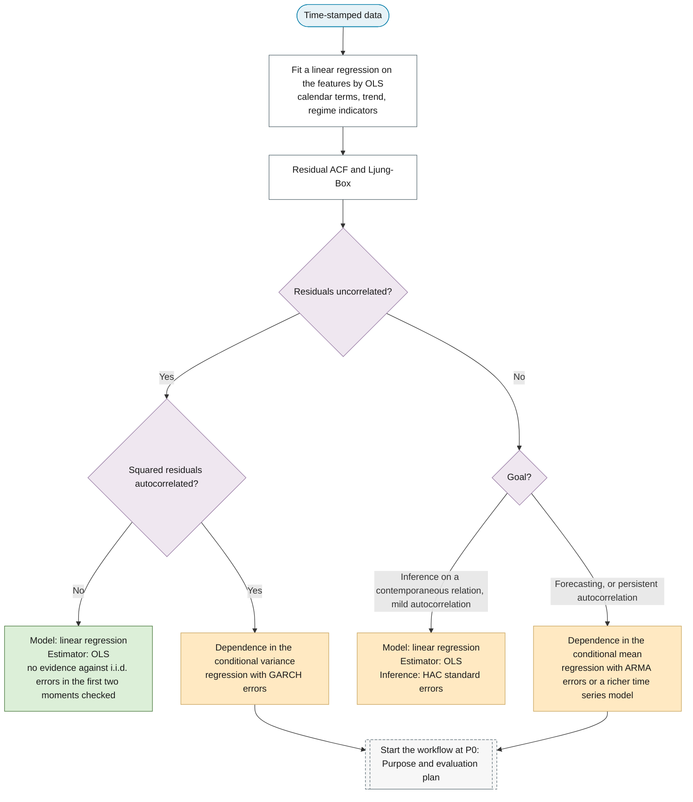

# Do You Need Time Series Analysis?

## When Time Orders the Observations

Not every dataset indexed by time requires time series methods. A time series is a sequence of observations indexed in time order — daily returns, monthly sales, hourly temperatures.

The distinction is whether **time orders the observations** or merely **labels them as a feature**. A customer-churn dataset may include signup date or account age as covariates while still treating each customer as exchangeable; shuffling the rows leaves the analysis unchanged. A daily stock price series, by contrast, falls apart under shuffling — each value's interpretation depends on what came immediately before.

## Feature Engineering vs Time Series Modelling

A dataset's temporal structure can take many forms. Calendar effects, a deterministic trend and regime indicators are **strictly exogenous features**: a linear regression on them, estimated by OLS, keeps the finite-sample Gauss–Markov results of the [OLS assumptions](ols-assumptions.md). Dependence on the series' own past can also be written with finite features — the lags $y_{t-1}, \ldots, y_{t-p}$ — and an AR($p$) model is a linear regression on them.

Two boundaries change the theory:

- **Predetermined instead of strictly exogenous regressors.** Lags of $y$ are correlated with past errors. OLS on them is biased in finite samples and is justified by large-sample asymptotics instead of the Gauss–Markov theorem ([Assumption 4](ols-assumptions.md#assumption-4)).
- **Dependence through unobserved past shocks.** A moving-average term makes $y_t$ depend on past shocks that are never observed; written in observable lags it is a regression on infinitely many of them. A finite parameterisation of that dependence has no closed-form least-squares solution and needs numerical estimation, usually by maximum likelihood.

Three situations admit a linear regression model — possibly with an inference adjustment — instead of a richer time series model:

- **Independent errors.** Some measurements carry no dependence from one period to the next once the regressors are accounted for — repeated lab measurements with no carryover, for example. If the residual ACF and the squared-residual ACF are flat at all non-zero lags, the data can be treated as cross-sectional.
- **Panel data with $N \gg T$.** When the cross-section is wide and the time dimension short, panel models (fixed effects, dynamic panel GMM) typically dominate per-unit time series models.
- **Contemporaneous-only inference.** When only the relationship between variables at the same time matters, the linear regression model is retained and estimated by OLS; only the inference layer is swapped, replacing conventional standard errors with heteroskedasticity-and-autocorrelation-consistent (HAC) standard errors — Newey and West (1987), for instance. This salvages inference without committing to a model of the error process.

## The Core Question: Independence of the Errors

The question is stated on the errors, not on $y$. After conditioning on the regressors, are the errors

$$\epsilon_t = y_t - \mathbb{E}[y_t \mid \mathbf{x}_t]$$

(Read: epsilon-sub-t equals y-sub-t minus the conditional expectation of y-sub-t given x-sub-t.)

i.i.d., or at least a martingale difference sequence, $\mathbb{E}[\epsilon_t \mid \epsilon_{t-1}, \epsilon_{t-2}, \ldots] = 0$? When they are, the temporal labels carry no statistical information beyond their role as identifiers, and the data can be treated as cross-sectional.

A persistent $y$ does not answer the question. With a persistent regressor $x_t$ and i.i.d. errors, $y_t = \beta x_t + \epsilon_t$ is autocorrelated, yet every Gauss–Markov condition holds. The checks therefore run on the residuals of a regression on the features:

- The residual ACF and the Ljung–Box test check **uncorrelatedness**. A flat residual ACF establishes uncorrelatedness only.
- The squared-residual ACF and the ARCH-LM test check one form of **dependence beyond correlation**. Errors with GARCH volatility have a flat ACF and dependent squares.

When the residuals show dependence, the question becomes along which dimension the dependence runs:

| Dependence runs along… | Model family |
|---|---|
| Group or individual (many units, repeated) | Panel / mixed effects |
| Space | Spatial econometrics, Gaussian processes |
| Hierarchy (e.g., students within schools) | Multilevel models |
| Time (one unit, ordered observations) | Time series — the workflow starting at [P0](../01-workflow/p00-purpose/index.md) |

## Workflow: From Residuals to a Decision

The decision distills into a sequence: fit a linear regression with the engineered features by OLS, check the residuals and their squares, and let the diagnostics decide whether the regression suffices or the time series workflow starts. Nothing is differenced or transformed here: those choices depend on the purpose, which the workflow fixes first in [P0](../01-workflow/p00-purpose/index.md).

Each terminal names the **model**, the **estimator** and, where relevant, the **inference layer**.

- **Linear regression terminal.** Uncorrelated residuals with uncorrelated squares give no evidence against i.i.d. errors in the first two moments checked. The model stays a linear regression, the estimator stays OLS, and conventional standard errors are valid.
- **HAC terminal.** Mild residual autocorrelation under an inference goal changes neither the model nor the estimator. Only the inference layer is swapped: HAC standard errors replace conventional ones.
- **Variance dependence.** Squared-residual autocorrelation shows dependence in the conditional variance. The mean equation is kept, a GARCH variance equation is added, and the joint model is estimated together.
- **Mean dependence.** Persistent residual autocorrelation shows that the mean model is misspecified. The regression with i.i.d. errors is *replaced* by a model that specifies an autocorrelated error process, most often regression with ARMA errors.

Both time series outcomes start the workflow at P0, because the purpose decides what the later phases may clean, transform and estimate. A slowly decaying residual ACF can also signal a unit root in the errors, which makes the regression spurious; [P3](../01-workflow/p03-exploratory-diagnostics.md) tests the integration order of the series and of the regressors.

The flowchart implies an allocation of work. Feature engineering absorbs the exogenous structure — calendar, regimes, deterministic trend. A time series model is reserved for the dependence that remains: condition on features first, and specify the error process only when conditioning leaves the errors dependent.

## What "Time Series Analysis" Means in This Flowchart

Escalating from a linear regression model with i.i.d. errors to a time series specification does not mean fitting a separate model on the OLS residuals. It means **replacing the model**. The canonical form is **regression with ARMA errors**:

$$y_t = \mathbf{x}_t^T \boldsymbol{\beta} + u_t, \qquad u_t \text{ follows an ARMA process.}$$

(Read: y at time t equals a linear combination of features x-sub-t plus an error u-sub-t that follows an autoregressive moving-average process.)

Here $u_t$ is a *theoretical* error term — what remains in $y_t$ after the features are accounted for — not the observed residual from a prior OLS fit. $\boldsymbol{\beta}$ and the ARMA parameters are estimated together by **maximum likelihood (MLE)** on the original $y_t$ data, not in sequence. **ARMA** (autoregressive moving-average) is a class of models in which $u_t$ depends on its own past values and on past random shocks. In this form $\boldsymbol{\beta}$ is the marginal effect of $\mathbf{x}_t$ on $\mathbb{E}[y_t \mid \mathbf{x}_t]$.

**ARIMAX** is a different model. It places the regressors inside the ARMA recursion, $\phi(B)\, y_t = \mathbf{x}_t^T \boldsymbol{\beta} + \theta(B)\, \epsilon_t$, so $\boldsymbol{\beta}$ is the impact of $\mathbf{x}_t$ on $y_t$ and the long-run effect is $\boldsymbol{\beta} / \phi(1)$ (Hyndman 2010). Reading ARIMAX coefficients as marginal effects confuses the two.

The OLS fit served only as a diagnostic step. The question it answered was whether the regression left uncorrelated residuals with uncorrelated squares. When the answer is no, that model is replaced, and the replacement is estimated on the original $y_t$. The estimator changes because the model changed — not the other way around.

**Cochrane–Orcutt (1949)** is the classical estimator for a regression with AR(1) errors. It estimates the AR coefficient $\rho$ from the OLS residuals, quasi-differences the data ($y_t - \hat{\rho} y_{t-1}$ and $\mathbf{x}_t - \hat{\rho} \mathbf{x}_{t-1}$), re-estimates $\boldsymbol{\beta}$ by OLS on the transformed data, and iterates. That is feasible generalised least squares. With strictly exogenous regressors it is asymptotically equivalent to GLS and to Gaussian MLE (Hamilton 1994, ch. 8); its finite-sample loss is the dropped first observation, which Prais and Winsten (1954) restore. With a lagged dependent variable among the regressors and autocorrelated errors, the first-stage OLS is inconsistent and the iteration can converge to an inconsistent solution (Betancourt and Kelejian 1981). Joint MLE covers ARMA errors of any order and remains valid with lagged dependent variables, which is why the workflow uses it.

**Regression with ARMA errors is the canonical, not the only, escalation.** Two other escalations start from the same baseline:

- **GARCH** addresses dependence in the conditional **variance** — volatility clustering. The mean model is retained, a GARCH variance equation is added, and the joint specification is estimated by MLE or Gaussian quasi-MLE.
- **HAC standard errors** address mild mean autocorrelation when inference, not forecasting, is the goal. Neither the model nor the point estimator changes; only the variance estimator used for standard errors is swapped.

Beyond these, the time series literature contains many specialised model families, each targeting a kind of dependence the flowchart does not resolve directly:

- **State-space models** (Kalman filter, structural time series, BSTS) — for time-varying level, trend, or coefficients; multiple overlapping seasonalities; missing observations; online updating. Estimated by MLE or Bayesian methods.
- **VAR and VECM** — for multivariate series in which each component depends on lagged values of the others; VECM for cointegrated nonstationary series. The lags are predetermined; equation-by-equation OLS on an unrestricted VAR equals conditional Gaussian MLE, and a VECM is estimated by Johansen's reduced-rank maximum likelihood.
- **Frequency-domain methods** (spectral analysis, wavelets) — when cycles do not align with integer divisors of the sampling rate, or when the question concerns energy distribution across frequencies rather than predicting individual values.
- **Long-memory models** (ARFIMA) — when the ACF decays too slowly for any finite ARMA to capture.
- **Regime-switching models** (Markov-switching) — when parameters shift between unobserved discrete states. Estimated by MLE via the Hamilton (1989) filter or by Bayesian methods.
- **Nonlinear and ML sequence models** (LSTM, transformers, N-BEATS) — for nonlinear dependence and high-dimensional inputs, given sufficient data. Trained by gradient-based optimization of a loss function.

These are developed along the [general flowchart](../01-workflow/index.md): the representation in [P5](../01-workflow/p05-representation/index.md), the model family in [P6](../01-workflow/p06-mean-model-class.md), the error process in [P7](../01-workflow/p07-error-process.md) and the estimator in [P8](../01-workflow/p08-estimation.md). The flowchart on this page is a gateway: it tells you whether the linear regression model with i.i.d. errors suffices, and if not, which broad axis of dependence — mean, variance, or inference only — the residuals point to.

## References

- Betancourt, R., and H. Kelejian. 1981. "Lagged Endogenous Variables and the Cochrane-Orcutt Procedure." *Econometrica* 49 (4): 1073–1078.
- Cochrane, D., and G. H. Orcutt. 1949. "Application of Least Squares Regression to Relationships Containing Auto-Correlated Error Terms." *Journal of the American Statistical Association* 44 (245): 32–61.
- Hamilton, J. D. 1989. "A New Approach to the Economic Analysis of Nonstationary Time Series and the Business Cycle." *Econometrica* 57 (2): 357–384.
- Hamilton, J. D. 1994. *Time Series Analysis*. Princeton: Princeton University Press.
- Hyndman, R. J. 2010. "The ARIMAX Model Muddle." Hyndsight blog, 4 October 2010.
- Newey, W. K., and K. D. West. 1987. "A Simple, Positive Semi-Definite, Heteroskedasticity and Autocorrelation Consistent Covariance Matrix." *Econometrica* 55 (3): 703–708.
- Prais, S. J., and C. B. Winsten. 1954. "Trend Estimators and Serial Correlation." Cowles Commission Discussion Paper No. 383, Chicago.
