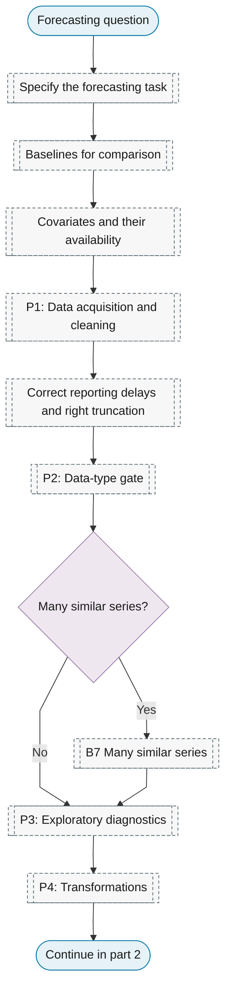
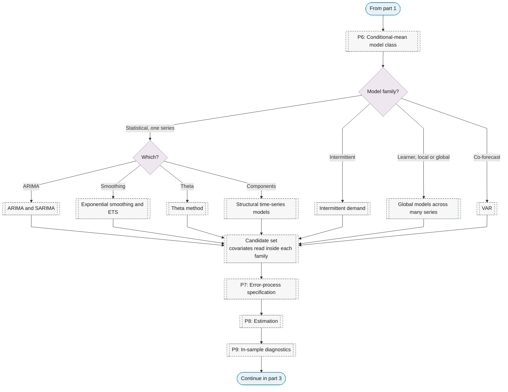

# Purpose 1: Forecasting

**Goal:** Predict future values with quantified uncertainty.

## Sub-chart

**Part 1: task, data and diagnostics.**

**Part 2: candidate families, estimation and diagnostics.**

**Part 3: out-of-sample evaluation, the issued product and deployment.**

```mermaid
%%{init: {"flowchart": {"curve": "linear"}}}%%
graph TD
    P0_FC_PART_3_IN(["From part 2"]) --> P10[["P10: Out-of-sample evaluation and selection"]]
    P10 --> P10_ROLLING_ORIGIN[["Rolling-origin backtesting"]]
    P10_ROLLING_ORIGIN --> P10_FORECAST_PRODUCT[["Complete forecast product per origin"]]
    P10_FORECAST_PRODUCT --> P10_POINT_METRICS[["Point-forecast metrics"]]
    P10_POINT_METRICS --> P10_PROBABILISTIC_METRICS[["Probabilistic metrics"]]
    P10_PROBABILISTIC_METRICS --> P10_FORECAST_COMPARISON[["Forecast comparison tests"]]
    P10_FORECAST_COMPARISON --> P10_FINAL_HOLDOUT[["Final hold-out or nested rolling origin"]]
    P10_FINAL_HOLDOUT --> P11[["P11: Inference and interpretation"]]
    P11 --> P11_POINT_FORECASTS[["Point forecasts and horizons"]]
    P11_POINT_FORECASTS --> P11_INTERVALS[["Prediction intervals"]]
    P11_INTERVALS --> P11_BACK_TRANSFORM[["Back-transformation and re-seasonalisation"]]
    P11_BACK_TRANSFORM --> P11_COMBINATION[["Forecast combination and model averaging"]]
    P11_COMBINATION --> P11_JUDGMENTAL[["Judgmental adjustment"]]
    P11_JUDGMENTAL -->|"Hierarchy flag"| P11_RECONCILIATION[["Hierarchical and temporal reconciliation"]]
    P11_JUDGMENTAL -->|"No hierarchy"| P0_FC_DOMAIN
    P11_RECONCILIATION --> P0_FC_DOMAIN{"Epidemic counts?"}
    P0_FC_DOMAIN -->|"Yes"| P0_FC_EPIDEMIC["Reproduction number and SIR fitting<br/>from the delay-corrected counts of P1"]
    P0_FC_DOMAIN -->|"No"| P12
    P0_FC_EPIDEMIC --> P12[["P12: Deployment and monitoring"]]
    class P0_FC_PART_3_IN terminator
    class P0_FC_DOMAIN decision
    class P0_FC_EPIDEMIC process
    class P10,P10_ROLLING_ORIGIN,P10_FORECAST_PRODUCT,P10_POINT_METRICS,P10_PROBABILISTIC_METRICS,P10_FORECAST_COMPARISON,P10_FINAL_HOLDOUT,P11,P11_POINT_FORECASTS,P11_INTERVALS,P11_BACK_TRANSFORM,P11_COMBINATION,P11_JUDGMENTAL,P11_RECONCILIATION,P12 ref
    classDef terminator fill:#E6F2F7,stroke:#007BA7,color:#1A1A1A;
    classDef process fill:#FFFFFF,stroke:#5A6B73,color:#1A1A1A;
    classDef decision fill:#EFE7F0,stroke:#9B7FA7,color:#1A1A1A;
    classDef data fill:#FFF4E0,stroke:#C9A55E,color:#1A1A1A;
    classDef good fill:#DCEFD8,stroke:#4A7A3F,color:#1A1A1A;
    classDef escalate fill:#FFE9C2,stroke:#C9A55E,color:#1A1A1A;
    classDef problem fill:#F2D9DE,stroke:#800020,color:#1A1A1A;
    classDef ref fill:#F7F7F7,stroke:#5A6B73,color:#1A1A1A,stroke-dasharray:4 3;
```

## P10 metrics for this purpose

[Rolling-origin backtesting](../p10-evaluation-selection.md#rolling-origin-backtesting), [Complete forecast product per origin](../p10-evaluation-selection.md#complete-forecast-product-per-origin), [Point-forecast metrics](../../reference/06-model-selection/index.md#point-forecast-metrics), [Probabilistic metrics](../../reference/34-probabilistic-forecasting/index.md#probabilistic-metrics), [Forecast comparison tests](../../reference/06-model-selection/index.md#forecast-comparison-tests).

## P11 inference for this purpose

[Point forecasts and horizons](../../reference/22-forecasting-practice/index.md#point-forecasts-and-horizons), [Prediction intervals](../../reference/34-probabilistic-forecasting/index.md#prediction-intervals), [Back-transformation and re-seasonalisation](../../reference/22-forecasting-practice/index.md#back-transformation-and-re-seasonalisation), [Forecast combination and model averaging](../../reference/22-forecasting-practice/index.md#forecast-combination-and-model-averaging), [Judgmental adjustment](../../reference/22-forecasting-practice/index.md#judgmental-adjustment), [Hierarchical and temporal reconciliation](../../reference/22-forecasting-practice/index.md#hierarchical-and-temporal-reconciliation), [Reproduction number and SIR fitting](../../reference/26-applied-domains/index.md#reproduction-number-and-sir-fitting).
