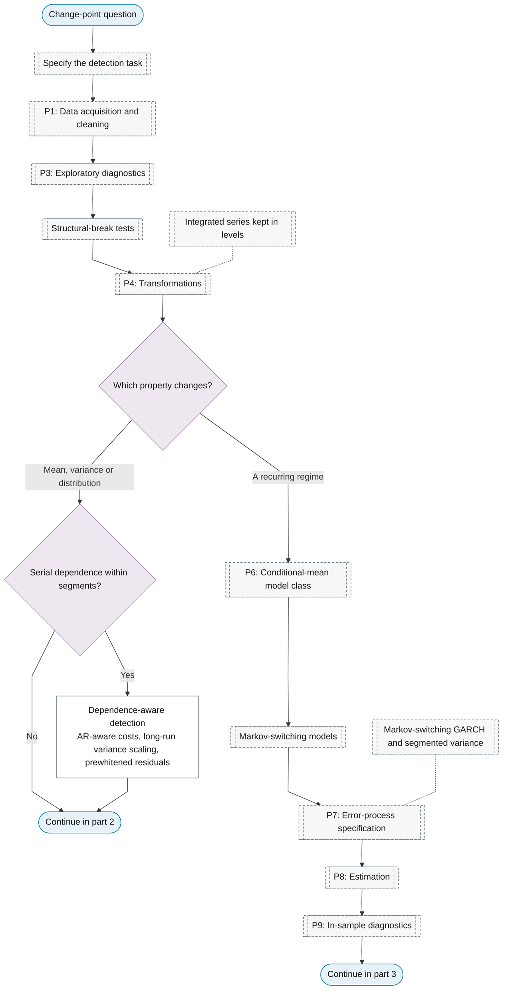
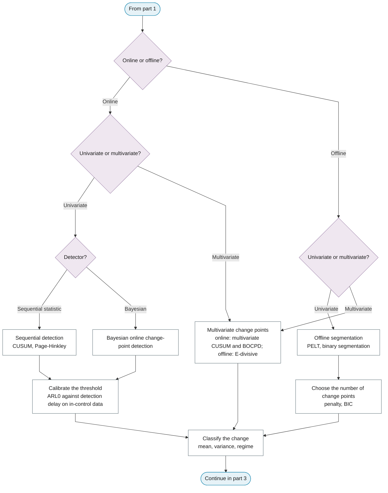
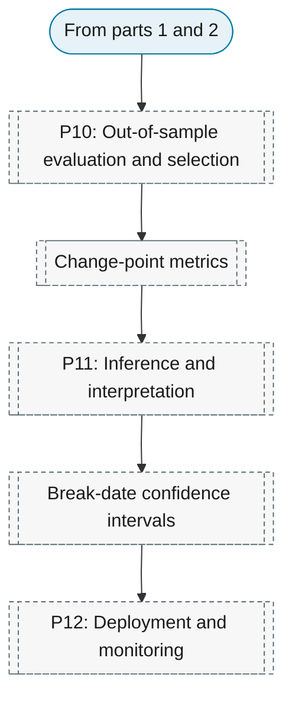

# Purpose 4: Change-point detection

**Goal:** Locate the times at which the statistical properties change.

## Sub-chart

**Part 1: task, data and the property that changes.**

**Part 2: online or offline, then dimension.**

**Part 3: evaluation, inference and deployment.**

## P10 metrics for this purpose

[Change-point metrics](../../reference/19-classification-anomaly/index.md#change-point-metrics).

## P11 inference for this purpose

[Break-date confidence intervals](../../reference/30-structural-change/index.md#break-date-confidence-intervals).
