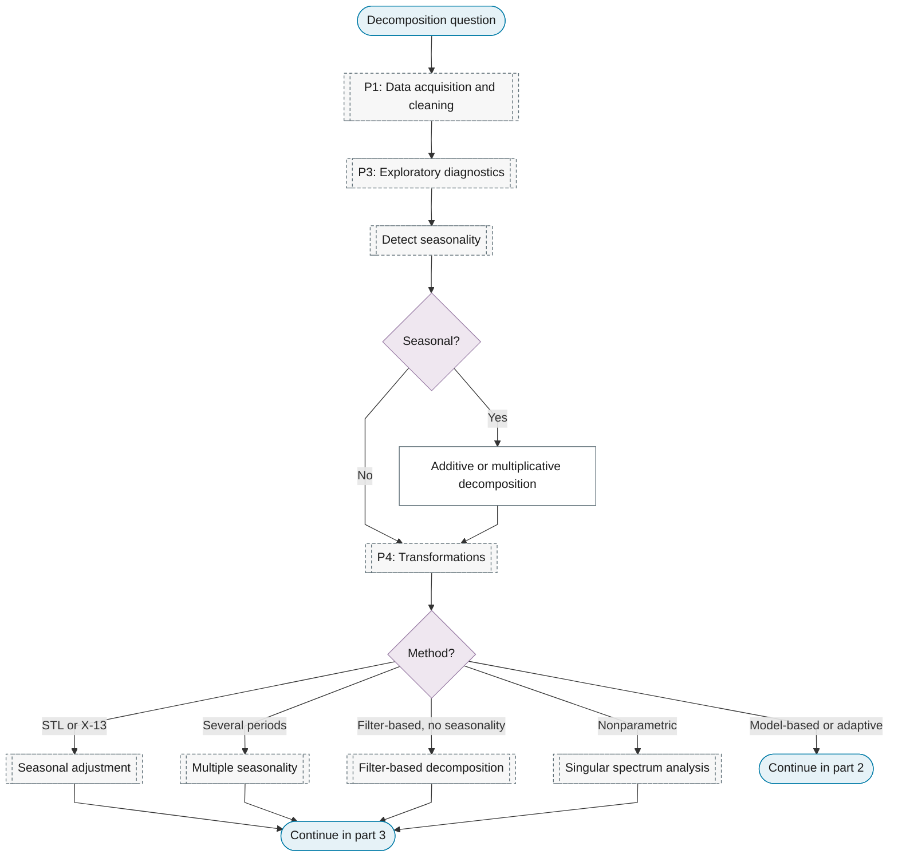
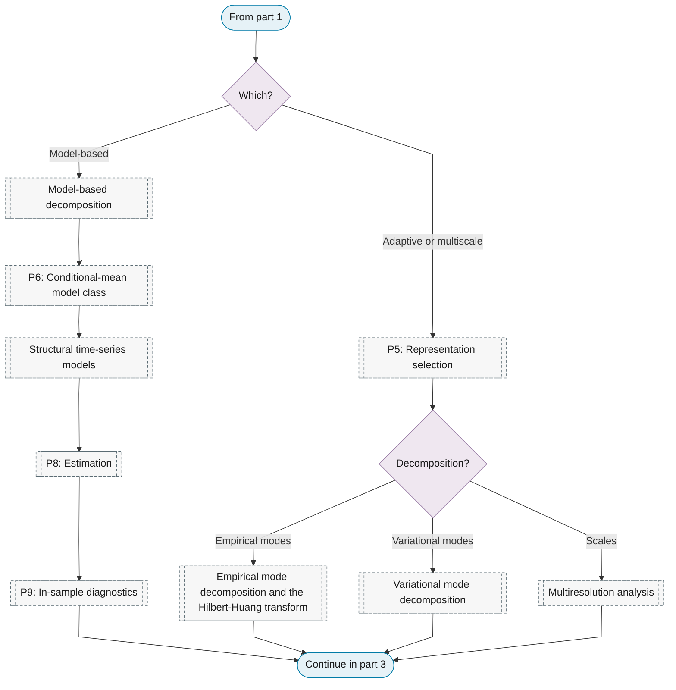
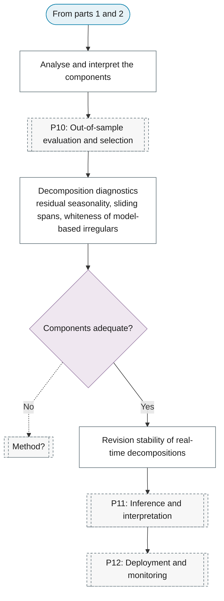

# Purpose 6: Decomposition

**Goal:** Split the series into interpretable components.

## Sub-chart

**Part 1: seasonality and the decomposition method, on the variance-stabilised levels.**

**Part 2: model-based, adaptive and multiscale methods.**

**Part 3: adequacy, interpretation and revisions.**

## P10 metrics for this purpose

[Decomposition diagnostics](../../reference/29-seasonality-calendar/index.md#decomposition-diagnostics), [Revision stability of real-time decompositions](../../reference/29-seasonality-calendar/index.md#revision-stability-of-real-time-decompositions).

## P11 inference for this purpose

[Analyse and interpret the components](../../reference/03-classical/index.md#analyse-and-interpret-the-components).
