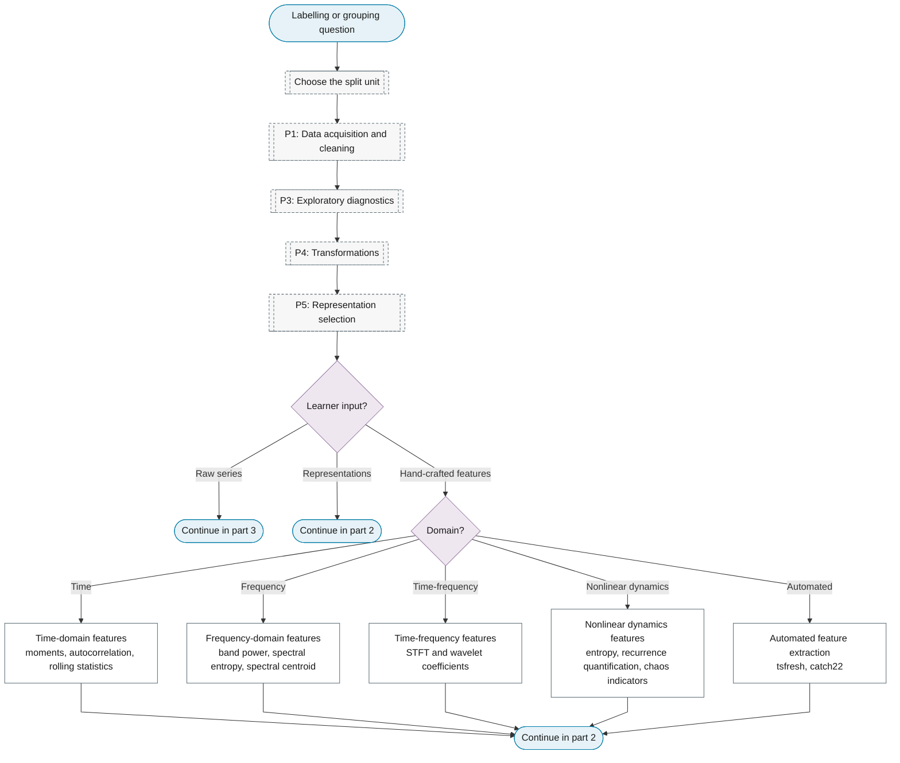
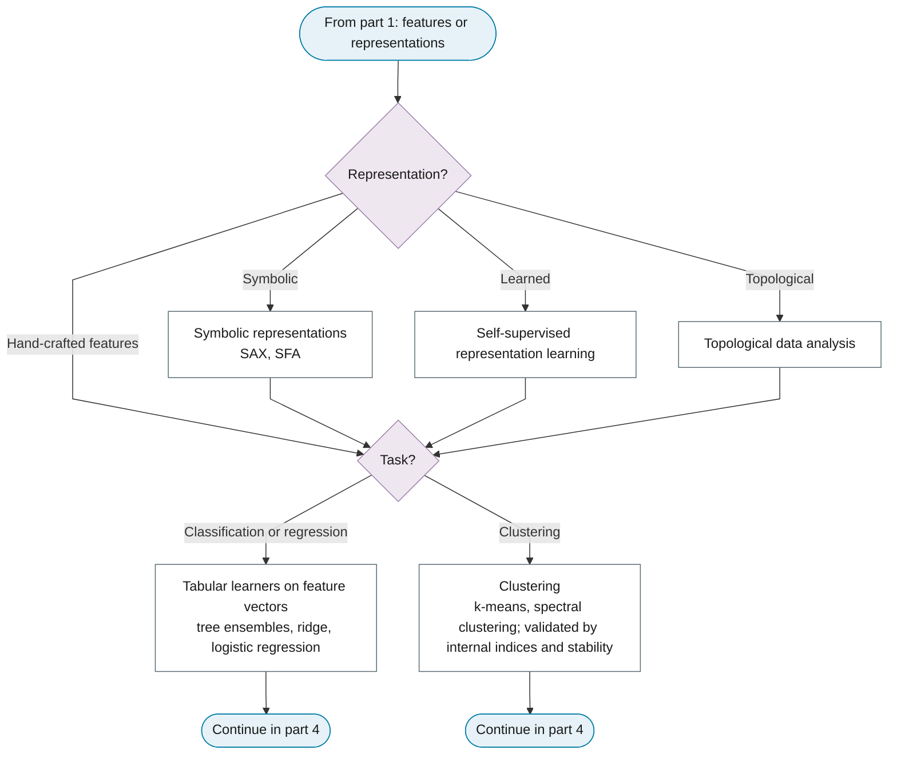
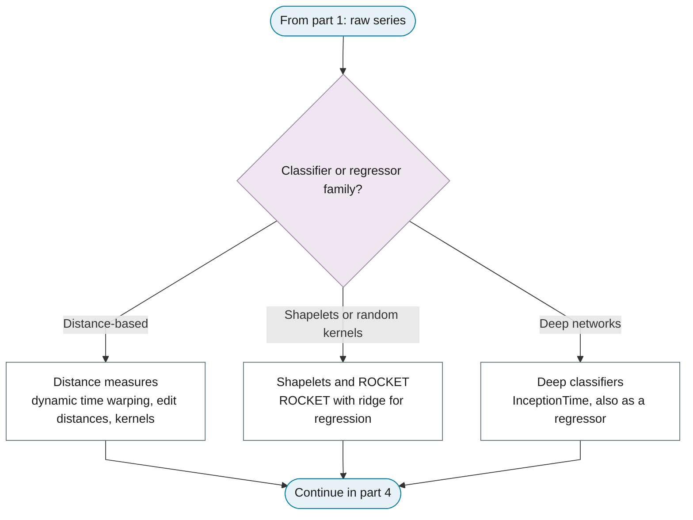
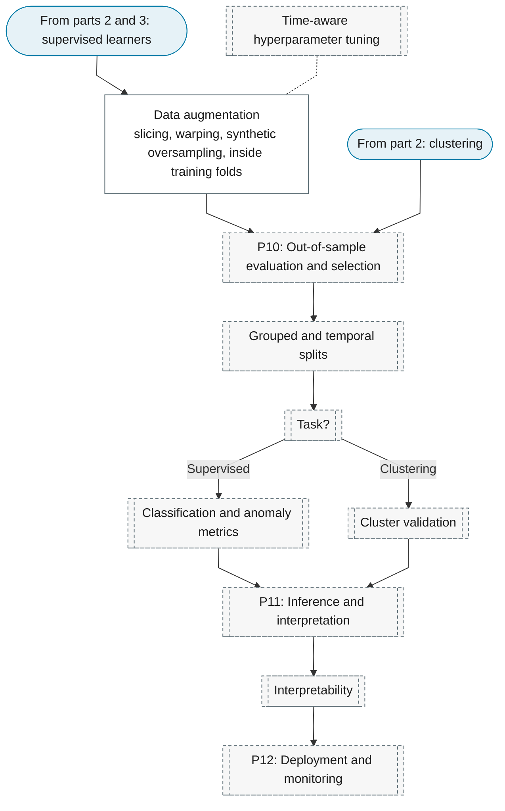

# Purpose 7: Feature extraction, classification and clustering

**Goal:** Turn series into feature vectors and learn labels or groups.

## Sub-chart

**Part 1: split unit, data and the learner input.**

**Part 2: representations and learners on feature vectors.**

**Part 3: learners on raw series.**

**Part 4: training, evaluation and interpretation.**

## P10 metrics for this purpose

[Grouped and temporal splits](../../reference/19-classification-anomaly/index.md#grouped-and-temporal-splits), [Classification and anomaly metrics](../../reference/19-classification-anomaly/index.md#classification-and-anomaly-metrics).

## P11 inference for this purpose

[Interpretability](../../reference/18-machine-learning/index.md#interpretability).
