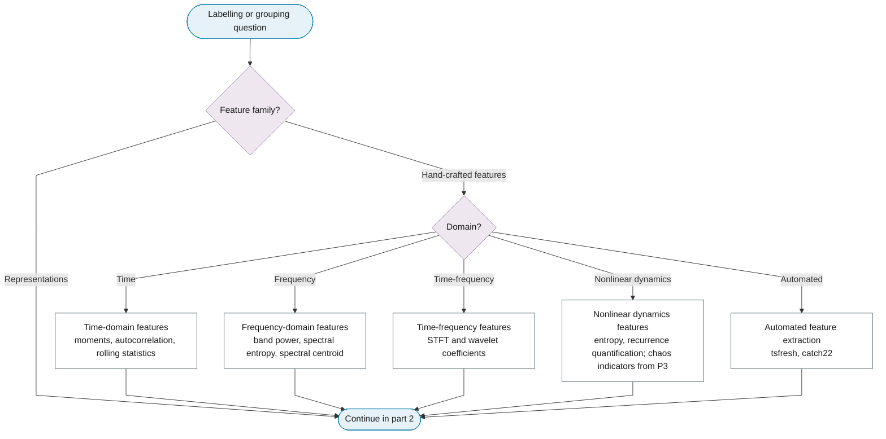
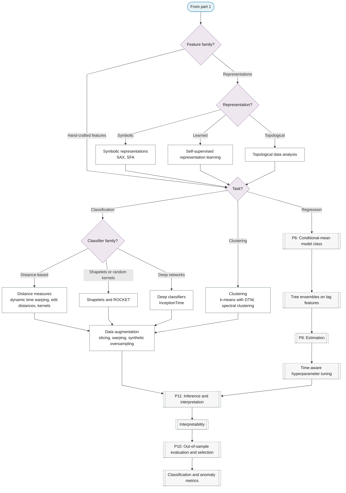

# Purpose 7: Feature extraction, classification and clustering

**Goal:** Turn series into feature vectors and learn labels or groups.

## Sub-chart

**Part 1: hand-crafted features.**

**Part 2: representations, learners and evaluation.**

## P11 inference for this purpose

[Interpretability](../../reference/18-machine-learning/index.md#interpretability).

## P10 metrics for this purpose

[Classification and anomaly metrics](../../reference/19-classification-anomaly/index.md#classification-and-anomaly-metrics).
