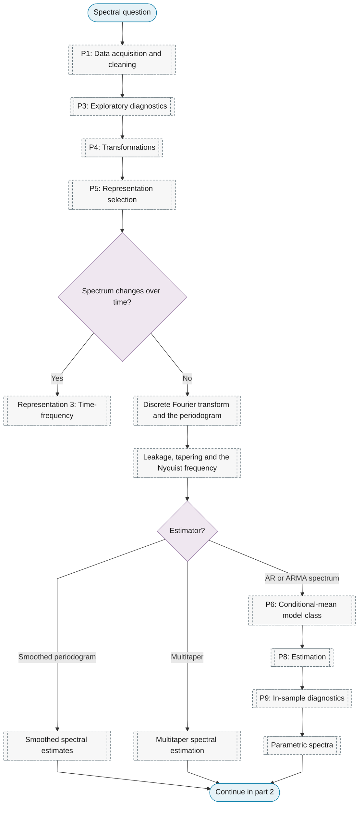
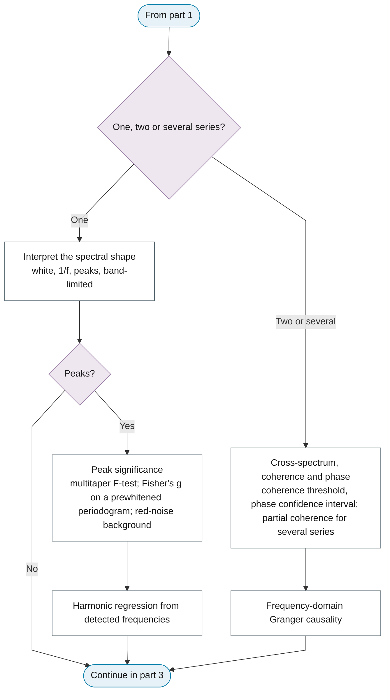
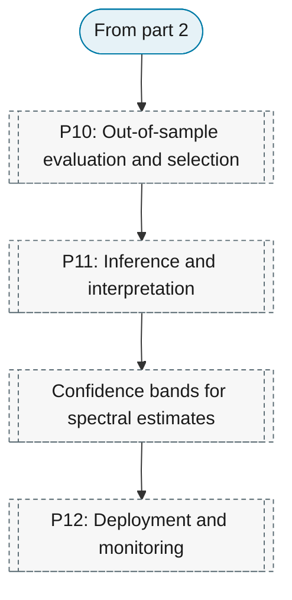

# Purpose 8: Spectral analysis

**Goal:** Describe the distribution of variance across frequencies.

## Sub-chart

**Part 1: data, representation and the estimator.**

**Part 2: one, two or several series.**

**Part 3: evaluation and inference.**

## P10 metrics for this purpose

[Peak significance](../../reference/13-spectral-analysis/index.md#peak-significance).

## P11 inference for this purpose

[Peak significance](../../reference/13-spectral-analysis/index.md#peak-significance), [Confidence bands for spectral estimates](../../reference/13-spectral-analysis/index.md#confidence-bands-for-spectral-estimates).
