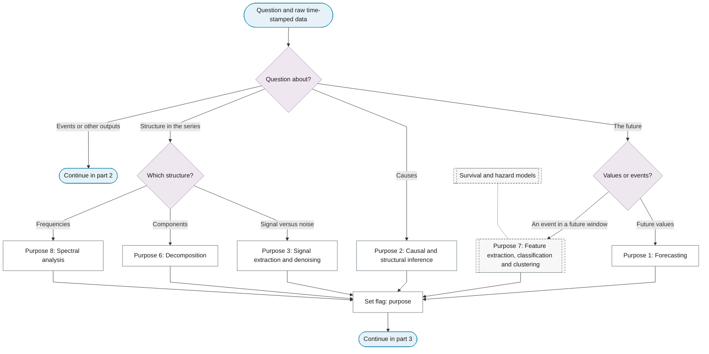
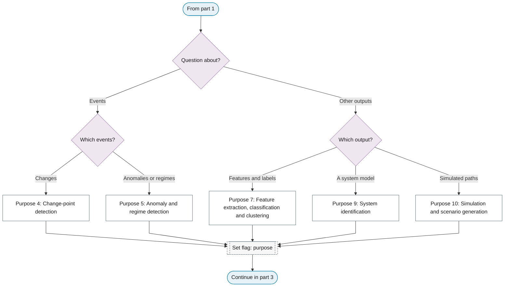
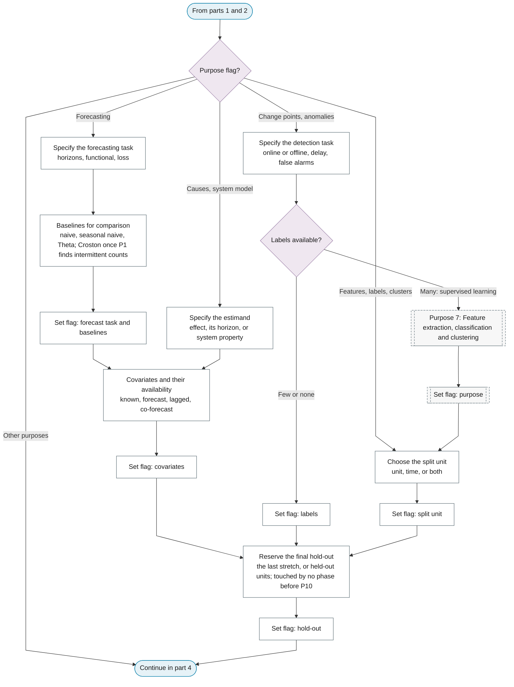
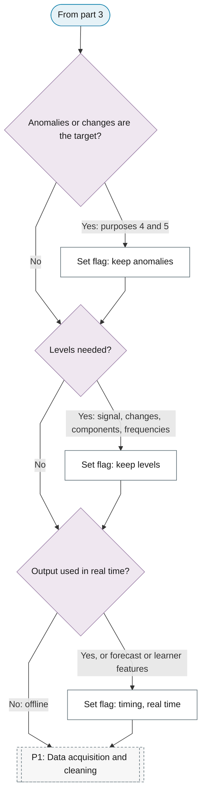

## Reserve the final hold-out

!!! note "Section pending"
    To-do item created from the flowchart inventory (node `P0_HOLDOUT`). Write this section following the content rules in `.claude/rules/writing.md`.

# P0: Purpose and evaluation plan

**Question this phase answers:** What is the question, how will the answer be judged, and what must the data keep?

The purpose comes first because it decides what cleaning may remove, what transformations may destroy and how the answer will be judged. Fixing these choices before looking at the data is pre-specification. Ten purposes are distinguished. Methods that belong to a purpose rather than to the standard pipeline (change-point algorithms, anomaly methods, component analysis, feature extraction, classification, clustering, simulation) are leaves of this phase.

## Purpose selector

**Part 1: the future, causes and structure in the series.**

**Part 2: events and other outputs.**

**Part 3: evaluation plan.**

**Part 4: what the data must keep, and when the output is used.**

The timing flag is set here once. Real time applies to live outputs, learner features and real-time detection: every two-sided step on their route (STL, X-13, gap filling by a smoother, centred windows) is replaced by its one-sided version. A statistical forecasting model fitted to adjusted data may keep the two-sided adjustment, because [P10](../p10-evaluation-selection.md#rolling-origin-backtesting) refits it inside each training window, where it sees only data before the origin; a learner's features stay one-sided, because a centred window at time s contains the targets after s.

## Quick navigation

Emphasised phases are the phases after P0 whose leaves the purpose's sub-chart routes through (dotted pointers excluded).

| Purpose | Emphasised phases | Key leaves |
|---|---|---|
| [1. Forecasting](01-forecasting.md) | P1, P6, P10, P11 | Baselines for comparison; Complete forecast product per origin; Reproduction number and SIR fitting |
| [2. Causal and structural inference](02-causal-inference.md) | P3, P6, P11 | Identification strategy and exogeneity; Placebo and falsification tests; Sensitivity analysis across specifications |
| [3. Signal extraction and denoising](03-signal-extraction.md) | P4, P5, P8, P10 | Characterise the noise; Wavelet denoising; Evaluate the signal-to-noise ratio |
| [4. Change-point detection](04-change-point-detection.md) | P3, P6, P10, P11 | Dependence-aware detection; Calibrate the threshold; Offline segmentation |
| [5. Anomaly and regime detection](05-anomaly-regime-detection.md) | P4, P6, P10, P12 | Statistical outlier scores; Matrix profile and discord discovery; Set thresholds by the cost of errors |
| [6. Decomposition](06-decomposition.md) | P3, P4, P5, P6 | Analyse and interpret the components; Decomposition diagnostics; Revision stability of real-time decompositions |
| [7. Feature extraction, classification and clustering](07-feature-extraction-classification.md) | P10, P11 | Time-domain features; Shapelets and ROCKET; Tabular learners on feature vectors |
| [8. Spectral analysis](08-spectral-analysis.md) | P5, P11 | Interpret the spectral shape; Peak significance; Cross-spectrum, coherence and phase |
| [9. System identification](09-system-identification.md) | P6 | Closed-loop identification; Nonparametric analysis of the system; Poles, zeros and stability |
| [10. Simulation and scenario generation](10-simulation.md) | P6, P11 | Monte Carlo simulation from a fitted model; Check distribution and dependence matching; Train on synthetic, test on real |

## Specify the forecasting task

!!! note "Section pending"
    To-do item created from the flowchart inventory (node `P0_FORECAST_TASK`). Write this section following the content rules in `.claude/rules/writing.md`.

## Specify the detection task

!!! note "Section pending"
    To-do item created from the flowchart inventory (node `P0_DETECTION_TASK`). Write this section following the content rules in `.claude/rules/writing.md`.

## Specify the estimand

!!! note "Section pending"
    To-do item created from the flowchart inventory (node `P0_ESTIMAND`). Write this section following the content rules in `.claude/rules/writing.md`.

## Choose the split unit

!!! note "Section pending"
    To-do item created from the flowchart inventory (node `P0_SPLIT_UNIT`). Write this section following the content rules in `.claude/rules/writing.md`.

## Covariates and their availability

!!! note "Section pending"
    To-do item created from the flowchart inventory (node `P0_COVARIATES`). Write this section following the content rules in `.claude/rules/writing.md`.
