# P1: Data acquisition and cleaning

**Question this phase answers:** What is measured, and is the series fit to analyse, without deciding anything the purpose decides?

The value type comes first because it decides which cleaning steps are valid: interpolation produces non-integers for counts, event times have nothing to impute, and stock and flow series aggregate differently. The phase then aligns and checks the record, corrects reporting delays on the raw scale, screens data errors, handles missing data and its imputation, and marks candidate outliers without replacing them: whether an outlier is removed, modelled or studied depends on the purpose, and that decision is taken in P4 and P6.

## Sub-diagram

```mermaid
%%{init: {"flowchart": {"curve": "linear"}}}%%
graph TD
    P1_IN(["Flags from P0 and raw time-stamped data"]) --> P1_VALUE_TYPE["Determine the value type<br/>continuous, counts, categorical, compositional, curves, events"]
    P1_VALUE_TYPE --> P1_VALUE_TYPE_FLAG["Set flag: value type"]
    P1_VALUE_TYPE_FLAG --> P1_INSPECT_SAMPLING["Inspect sampling rate and resolution<br/>signal bandwidth against Nyquist; anti-alias filter at acquisition"]
    P1_INSPECT_SAMPLING --> P1_ALIGN_TIMESTAMPS["Align timestamps<br/>time zones, daylight-saving transitions"]
    P1_ALIGN_TIMESTAMPS --> P1_REGULAR{"Regular sampling?"}
    P1_REGULAR -->|"No"| P1_IRREGULAR_FLAG["Set flag: irregular sampling"]
    P1_REGULAR -->|"Yes"| P1_DEDUPLICATE
    P1_IRREGULAR_FLAG --> P1_DEDUPLICATE["Remove duplicate and out-of-order stamps"]
    P1_DEDUPLICATE --> P1_UNITS_METADATA["Check units and metadata"]
    P1_UNITS_METADATA --> P1_CUMULATIVE{"Cumulative measure?"}
    P1_CUMULATIVE -->|"Yes"| P1_CUMULATIVE_TO_FLOW["Convert cumulative series to flows"]
    P1_CUMULATIVE -->|"No"| P1_CALENDAR
    P1_CUMULATIVE_TO_FLOW --> P1_CALENDAR{"Calendar effects?"}
    P1_CALENDAR -->|"Yes"| P1_CALENDAR_EFFECTS["Mark calendar effects<br/>trading days, holidays, leap years"]
    P1_CALENDAR -->|"No"| P1_DELAY
    P1_CALENDAR_EFFECTS --> P1_CALENDAR_FLAG["Set flag: calendar effects"]
    P1_CALENDAR_FLAG --> P1_DELAY{"Reporting delays?"}
    P1_DELAY -->|"Yes"| P1_REPORTING_DELAY["Correct reporting delays and right truncation<br/>nowcast on the raw scale"]
    P1_DELAY -->|"No"| P1_VINTAGES
    P1_REPORTING_DELAY --> P1_DELAY_FLAG["Set flag: reporting delay"]
    P1_DELAY_FLAG --> P1_VINTAGES["Track revisions and real-time vintages"]
    P1_VINTAGES --> P1_SCREEN["Screen data errors and mark candidate outliers<br/>correct errors, or label them when anomalies are kept"]
    P1_SCREEN --> P1_OUTLIER_FLAG["Set flag: candidate outliers"]
    P1_OUTLIER_FLAG --> P1_HAS_MISSING{"Missing values?"}
    P1_HAS_MISSING -->|"Short gaps in a continuous series"| P1_MISSING_IMPUTE["Impute missing values<br/>interpolation, Kalman smoother; one-sided in real time"]
    P1_HAS_MISSING -->|"Long gaps"| P1_MISSING_SEGMENT["Segment around long gaps"]
    P1_HAS_MISSING -->|"None, or counts and events left missing"| P1_RESAMPLE_NOW
    P1_MISSING_IMPUTE --> P1_IMPUTED_FLAG["Set flag: imputed"]
    P1_IMPUTED_FLAG & P1_MISSING_SEGMENT --> P1_RESAMPLE_NOW{"Resample now?"}
    P1_RESAMPLE_NOW -->|"Yes: purpose needs a coarser or regular grid"| P1_RESAMPLE["Resample and anti-alias<br/>sum flows, sample stocks; averaging adds MA terms"]
    P1_RESAMPLE_NOW -->|"No: keep the sampling"| P1_FREQUENCY
    P1_RESAMPLE --> P1_FREQUENCY{"Frequency conversion?"}
    P1_FREQUENCY -->|"Yes"| P1_DISAGGREGATION["Temporal disaggregation and benchmarking<br/>Chow-Lin, Denton"]
    P1_FREQUENCY -->|"No"| P2[["P2: Data-type gate"]]
    P1_DISAGGREGATION --> P2
    class P1_IN terminator
    class P1_REGULAR,P1_CUMULATIVE,P1_CALENDAR,P1_DELAY,P1_HAS_MISSING,P1_RESAMPLE_NOW,P1_FREQUENCY decision
    class P1_VALUE_TYPE,P1_VALUE_TYPE_FLAG,P1_INSPECT_SAMPLING,P1_ALIGN_TIMESTAMPS,P1_IRREGULAR_FLAG,P1_DEDUPLICATE,P1_UNITS_METADATA,P1_CUMULATIVE_TO_FLOW,P1_CALENDAR_EFFECTS,P1_CALENDAR_FLAG,P1_REPORTING_DELAY,P1_DELAY_FLAG,P1_VINTAGES,P1_SCREEN,P1_OUTLIER_FLAG,P1_MISSING_IMPUTE,P1_MISSING_SEGMENT,P1_IMPUTED_FLAG,P1_RESAMPLE,P1_DISAGGREGATION process
    class P2 ref
    classDef terminator fill:#E6F2F7,stroke:#007BA7,color:#1A1A1A;
    classDef process fill:#FFFFFF,stroke:#5A6B73,color:#1A1A1A;
    classDef decision fill:#EFE7F0,stroke:#9B7FA7,color:#1A1A1A;
    classDef data fill:#FFF4E0,stroke:#C9A55E,color:#1A1A1A;
    classDef good fill:#DCEFD8,stroke:#4A7A3F,color:#1A1A1A;
    classDef escalate fill:#FFE9C2,stroke:#C9A55E,color:#1A1A1A;
    classDef problem fill:#F2D9DE,stroke:#800020,color:#1A1A1A;
    classDef ref fill:#F7F7F7,stroke:#5A6B73,color:#1A1A1A,stroke-dasharray:4 3;
```

A series counts as a count series when its values are small or often zero, decided per series; large counts, such as passenger numbers, are treated as continuous, so log transforms and ARIMA stay available. Two-sided steps (interpolation, the Kalman smoother) are used in their one-sided form when the real-time flag is set; a forecaster may keep them two-sided because P10 refits them inside each training window.

## Phase guide

!!! note "Section pending"
    To-do item created from the flowchart inventory (node `P1`). Write this section following the content rules in `.claude/rules/writing.md`.

## Determine the value type

!!! note "Section pending"
    To-do item created from the flowchart inventory (node `P1_VALUE_TYPE`). Write this section following the content rules in `.claude/rules/writing.md`.

## Inspect sampling rate and resolution

!!! note "Section pending"
    To-do item created from the flowchart inventory (node `P1_INSPECT_SAMPLING`). Write this section following the content rules in `.claude/rules/writing.md`.

## Align timestamps

!!! note "Section pending"
    To-do item created from the flowchart inventory (node `P1_ALIGN_TIMESTAMPS`). Write this section following the content rules in `.claude/rules/writing.md`.

## Remove duplicate and out-of-order stamps

!!! note "Section pending"
    To-do item created from the flowchart inventory (node `P1_DEDUPLICATE`). Write this section following the content rules in `.claude/rules/writing.md`.

## Check units and metadata

!!! note "Section pending"
    To-do item created from the flowchart inventory (node `P1_UNITS_METADATA`). Write this section following the content rules in `.claude/rules/writing.md`.

## Convert cumulative series to flows

!!! note "Section pending"
    To-do item created from the flowchart inventory (node `P1_CUMULATIVE_TO_FLOW`). Write this section following the content rules in `.claude/rules/writing.md`.

## Mark calendar effects

!!! note "Section pending"
    To-do item created from the flowchart inventory (node `P1_CALENDAR_EFFECTS`). Write this section following the content rules in `.claude/rules/writing.md`.

## Correct reporting delays and right truncation

!!! note "Section pending"
    To-do item created from the flowchart inventory (node `P1_REPORTING_DELAY`). Write this section following the content rules in `.claude/rules/writing.md`.

## Track revisions and real-time vintages

!!! note "Section pending"
    To-do item created from the flowchart inventory (node `P1_VINTAGES`). Write this section following the content rules in `.claude/rules/writing.md`.

## Screen data errors and mark candidate outliers

!!! note "Section pending"
    To-do item created from the flowchart inventory (node `P1_SCREEN`). Write this section following the content rules in `.claude/rules/writing.md`.

## Impute missing values

!!! note "Section pending"
    To-do item created from the flowchart inventory (node `P1_MISSING_IMPUTE`). Write this section following the content rules in `.claude/rules/writing.md`.

## Segment around long gaps

!!! note "Section pending"
    To-do item created from the flowchart inventory (node `P1_MISSING_SEGMENT`). Write this section following the content rules in `.claude/rules/writing.md`.

## Resample and anti-alias

!!! note "Section pending"
    To-do item created from the flowchart inventory (node `P1_RESAMPLE`). Write this section following the content rules in `.claude/rules/writing.md`.

## Temporal disaggregation and benchmarking

!!! note "Section pending"
    To-do item created from the flowchart inventory (node `P1_DISAGGREGATION`). Write this section following the content rules in `.claude/rules/writing.md`.
