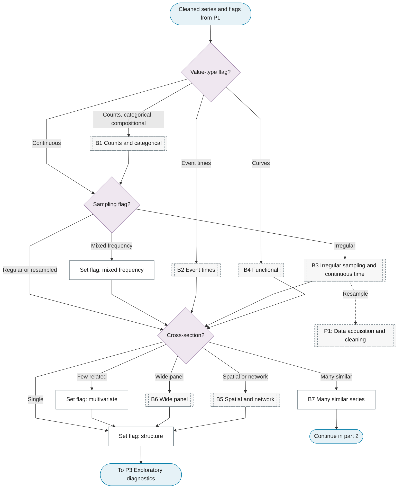
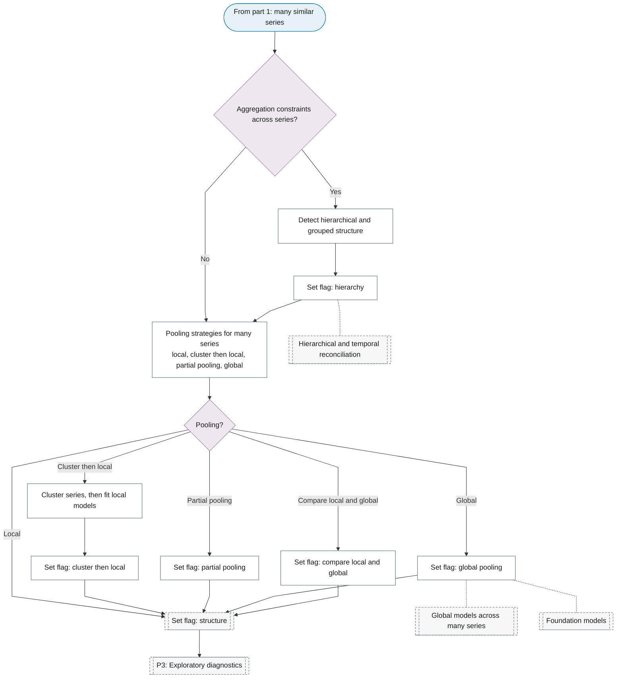

# P2: Data-type gate

**Question this phase answers:** How is the series sampled, and how are the series related?

The value type and the sampling were recorded in P1 on aligned, de-duplicated data. This phase reads them, asks the cross-sectional question for every series, and sends every type on to P3. The type flags are read by P3 to P9, and each branch chart is an index over the spine: it lists the type-specific leaves that the spine phases point to, in phase order.

## Sub-diagram

## Routing variables

| Variable | Values | Effect |
|---|---|---|
| Value type (set in P1) | continuous / counts / categorical or ordinal / compositional / curves / event times | Read by P3 to P9; counts are series with small values or frequent zeros, decided per series, and large counts are continuous; counts, categorical and compositional series use the B1 leaves, curves the B4 leaves, event times the B2 leaves |
| Sampling | regular or irregular (set in P1), irregular resampled (set in P1 after B3), irregular kept (set in B3), mixed frequency (set here) | Asked for every type except event times and curves, whose sampling per curve P5 reads (dense or sparse); irregular series use the B3 leaves, which ask whether to resample; mixed frequency is read by P3 to P6 and P11 |
| Cross-sectional structure (set here) | single / few related / many similar / wide panel / spatial or network | Asked for every series and read by P3 and P6; few related sets the multivariate flag; many similar uses B7; wide panel uses B6; spatial uses B5 |

## Branches

Every type reaches P3 through this page. A branch chart draws the spine phases it uses, in order, with its own leaves inside them, and hands the reader back to the spine at the phase in the last column.

| Branch | Chapter | Its leaves sit in | Back on the spine at |
|---|---|---|---|
| B1 Counts and categorical | [Count and Categorical](../reference/16-count-categorical/index.md) | P3, P6 | P10; compositions at P3, as log-ratios |
| B2 Event times | [Point Processes](../reference/17-point-processes/index.md) | P3, P6, P9 | P10 |
| B3 Irregular sampling and continuous time | [Continuous-Time Models](../reference/15-continuous-time/index.md) | P3, P6, P8, P9; may resample back to P1 | P10 |
| B4 Functional | [Functional and High-Frequency](../reference/14-functional-high-frequency/index.md) | P5 | P7 |
| B5 Spatial and network | [Spatio-Temporal Models](../reference/20-spatio-temporal/index.md) | P3, P6 | P10 |
| B6 Wide panel | [Panel Time Series](../reference/32-panel-time-series/index.md) | P3, P6, P8 | P10 |
| B7 Many similar series | this page | sets the hierarchy and pooling flags read by P6, P10 and P11 | P3 |

## B7 Many similar series

!!! note "Section pending"
    To-do item created from the flowchart inventory (node `B7`). Write this section following the content rules in `.claude/rules/writing.md`.

