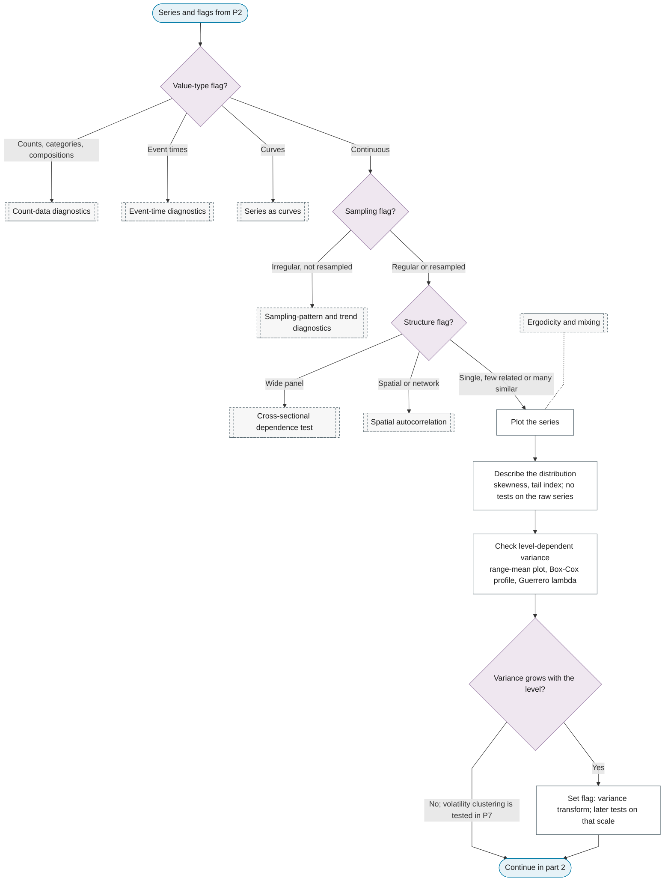
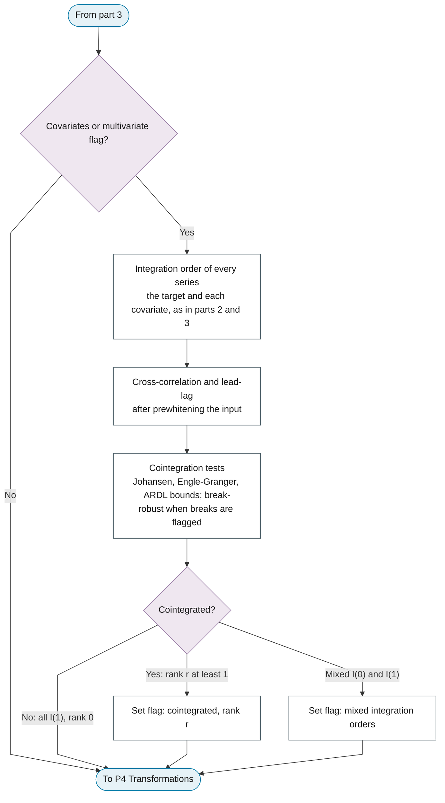

# P3: Exploratory diagnostics

**Question this phase answers:** What structure is present?

Valid diagnostics depend on the value type, the sampling and the cross-sectional structure: unit-root and ACF theory assumes a regularly sampled continuous series, so other types use their branch diagnostics. For a continuous series the scale is chosen first and every later test runs on it. Seasonal unit roots are tested at all frequencies together, explosive episodes are dated before the integration verdict, ADF-type and KPSS results are read together, breaks are tested with methods valid under either integration order, and the memory parameter d is estimated on the levels. The integration flag is the single source of d: agreeing tests propose an integer order k, and the estimate of d confirms it or replaces it.

## Sub-diagram

**Part 1: type, scale and variance.**

**Part 2: seasonality, explosive episodes, unit roots and breaks.**

```mermaid
%%{init: {"flowchart": {"curve": "linear"}}}%%
graph TD
    P3_PART_2_IN(["From part 1"]) --> P3_SEASONALITY["Detect seasonality<br/>seasonal subseries, periodogram peaks"]
    P3_SEASONALITY --> P3_SEASONAL{"Seasonal?"}
    P3_SEASONAL -->|"Single period"| P3_SEASONAL_UNIT_ROOT["Seasonal unit-root tests<br/>HEGY with its deterministic terms, OCSB, Canova-Hansen"]
    P3_SEASONAL -->|"Multiple periods"| P3_MULTI_SEASON_FLAG["Set flag: multiple seasonality"]
    P3_SEASONAL -->|"No"| P3_EXPLOSIVE_Q
    P3_SEASONAL_UNIT_ROOT --> P3_SUR_VERDICT{"Seasonal unit roots?"}
    P3_SUR_VERDICT -->|"Yes"| P3_SEASONAL_FILTER_FLAG["Set flag: seasonal filter; zero frequency from HEGY"]
    P3_SUR_VERDICT -->|"No"| P3_DET_SEASON_FLAG["Set flag: deterministic seasonality"]
    P3_SEASONAL_FILTER_FLAG & P3_DET_SEASON_FLAG & P3_MULTI_SEASON_FLAG --> P3_EXPLOSIVE_Q{"Explosive episode suspected?"}
    P3_EXPLOSIVE_Q -->|"Yes"| P3_EXPLOSIVE["Explosive-root and bubble tests<br/>right-tailed SADF and GSADF on the log scale; date stamping"]
    P3_EXPLOSIVE_Q -->|"No"| P3_TREND_TYPE
    P3_EXPLOSIVE --> P3_EXPLOSIVE_VERDICT{"Explosive episode?"}
    P3_EXPLOSIVE_VERDICT -->|"Yes"| P3_EXPLOSIVE_FLAG["Set flag: explosive episode; later tests exclude it"]
    P3_EXPLOSIVE_VERDICT -->|"No"| P3_TREND_TYPE
    P3_EXPLOSIVE_FLAG --> P3_TREND_TYPE["Trend-stationary or difference-stationary<br/>deterministic terms chosen with the tests; sequential procedure"]
    P3_TREND_TYPE --> P3_UNIT_ROOT["Unit-root tests<br/>ADF, KPSS, PP, DF-GLS; outlier dummies; highest order first"]
    P3_UNIT_ROOT --> P3_UR_VERDICT{"ADF-type and KPSS agree?"}
    P3_UR_VERDICT -->|"Agree: they propose k"| P3_BREAK_SUSPECTED{"Break suspected?"}
    P3_UR_VERDICT -->|"Conflict"| P3_STRUCTURAL_BREAKS
    P3_BREAK_SUSPECTED -->|"Yes"| P3_STRUCTURAL_BREAKS["Structural-break tests<br/>robust to I(0) and I(1): Perron-Yabu, Harvey-Leybourne-Taylor"]
    P3_BREAK_SUSPECTED -->|"No"| P3_TO_PART_3(["Continue in part 3"])
    P3_STRUCTURAL_BREAKS --> P3_UNIT_ROOT_BREAKS["Unit-root tests with breaks<br/>Lee-Strazicich; Perron for a known date"]
    P3_UNIT_ROOT_BREAKS --> P3_BREAK_VERDICT{"Breaks found?"}
    P3_BREAK_VERDICT -->|"Yes"| P3_BREAK_FLAG["Set flag: breaks, with dates"]
    P3_BREAK_VERDICT -->|"No"| P3_TO_PART_3
    P3_BREAK_FLAG --> P3_TO_PART_3
    F_STATIONARITY[["Strict and weak stationarity"]] -.- P3_TREND_TYPE
    F_UNIT_ROOT_ASYMPTOTICS[["Random walks and unit-root asymptotics<br/>near-unit-root asymptotics"]] -.- P3_UNIT_ROOT
    class P3_PART_2_IN,P3_TO_PART_3 terminator
    class P3_SEASONAL,P3_SUR_VERDICT,P3_EXPLOSIVE_Q,P3_EXPLOSIVE_VERDICT,P3_UR_VERDICT,P3_BREAK_SUSPECTED,P3_BREAK_VERDICT decision
    class P3_SEASONALITY,P3_SEASONAL_UNIT_ROOT,P3_MULTI_SEASON_FLAG,P3_SEASONAL_FILTER_FLAG,P3_DET_SEASON_FLAG,P3_EXPLOSIVE,P3_EXPLOSIVE_FLAG,P3_TREND_TYPE,P3_UNIT_ROOT,P3_STRUCTURAL_BREAKS,P3_UNIT_ROOT_BREAKS,P3_BREAK_FLAG process
    class F_STATIONARITY,F_UNIT_ROOT_ASYMPTOTICS ref
    classDef terminator fill:#E6F2F7,stroke:#007BA7,color:#1A1A1A;
    classDef process fill:#FFFFFF,stroke:#5A6B73,color:#1A1A1A;
    classDef decision fill:#EFE7F0,stroke:#9B7FA7,color:#1A1A1A;
    classDef data fill:#FFF4E0,stroke:#C9A55E,color:#1A1A1A;
    classDef good fill:#DCEFD8,stroke:#4A7A3F,color:#1A1A1A;
    classDef escalate fill:#FFE9C2,stroke:#C9A55E,color:#1A1A1A;
    classDef problem fill:#F2D9DE,stroke:#800020,color:#1A1A1A;
    classDef ref fill:#F7F7F7,stroke:#5A6B73,color:#1A1A1A,stroke-dasharray:4 3;
```

**Part 3: memory, trend, autocorrelation and nonlinearity.**

```mermaid
%%{init: {"flowchart": {"curve": "linear"}}}%%
graph TD
    P3_PART_3_IN(["From part 2"]) --> P3_LONG_MEMORY["Estimate the memory parameter d<br/>exact local Whittle with bias control, Robinson tests"]
    P3_LONG_MEMORY --> P3_LM_BREAKS{"Break flag set?"}
    P3_LM_BREAKS -->|"Yes"| P3_LM_VS_BREAKS["Long memory or breaks<br/>Qu test, Shimotsu sample splitting"]
    P3_LM_BREAKS -->|"No"| P3_ORDER_FLAG
    P3_LM_VS_BREAKS --> P3_ORDER_FLAG["Set flag: integration order k and fractional remainder"]
    P3_ORDER_FLAG --> P3_NONPARAMETRIC_TREND["Nonparametric trend tests<br/>Mann-Kendall with prewhitening, Sen slope"]
    P3_NONPARAMETRIC_TREND --> P3_TREND_TS{"Deterministic trend?"}
    P3_TREND_TS -->|"Yes"| P3_TREND_FLAG["Set flag: deterministic trend"]
    P3_TREND_TS -->|"No"| P3_ACF_PACF
    P3_TREND_FLAG --> P3_ACF_PACF["Read the ACF and PACF<br/>at the integration order; bands for i.i.d. noise, robust bands otherwise"]
    P3_ACF_PACF --> P3_VARIANCE_RATIO["Variance-ratio test<br/>Lo-MacKinlay, on the increments"]
    P3_VARIANCE_RATIO --> P3_NONLINEARITY["Nonlinearity tests<br/>BDS, Terasvirta, Tsay, Keenan on residuals of a linear AR; robust versions"]
    P3_NONLINEARITY --> P3_NONLINEAR{"Nonlinear mean?"}
    P3_NONLINEAR -->|"Yes"| P3_NONLINEAR_FLAG["Set flag: nonlinear"]
    P3_NONLINEAR -->|"No, or variance only: tested in P7"| P3_TO_PART_4(["Continue in part 4"])
    P3_NONLINEAR_FLAG --> P3_TO_PART_4
    class P3_PART_3_IN,P3_TO_PART_4 terminator
    class P3_LM_BREAKS,P3_TREND_TS,P3_NONLINEAR decision
    class P3_LONG_MEMORY,P3_LM_VS_BREAKS,P3_ORDER_FLAG,P3_NONPARAMETRIC_TREND,P3_TREND_FLAG,P3_ACF_PACF,P3_VARIANCE_RATIO,P3_NONLINEARITY,P3_NONLINEAR_FLAG process
    classDef terminator fill:#E6F2F7,stroke:#007BA7,color:#1A1A1A;
    classDef process fill:#FFFFFF,stroke:#5A6B73,color:#1A1A1A;
    classDef decision fill:#EFE7F0,stroke:#9B7FA7,color:#1A1A1A;
    classDef data fill:#FFF4E0,stroke:#C9A55E,color:#1A1A1A;
    classDef good fill:#DCEFD8,stroke:#4A7A3F,color:#1A1A1A;
    classDef escalate fill:#FFE9C2,stroke:#C9A55E,color:#1A1A1A;
    classDef problem fill:#F2D9DE,stroke:#800020,color:#1A1A1A;
    classDef ref fill:#F7F7F7,stroke:#5A6B73,color:#1A1A1A,stroke-dasharray:4 3;
```

**Part 4: covariates and related series.**

The ADF-type and KPSS decision matrix (both reject, neither rejects, one rejects) reads the tests as the logic page explains non-rejection: failing to reject is weak evidence. Agreement proposes the integer order k; the exact local Whittle estimate confirms k when its bias-controlled interval contains it and replaces it with the nearest integer to the estimate otherwise. When k = 2 is proposed, or a trend is included and the estimate exceeds 1.5, the estimator runs on the differences and adds 1. A fractional remainder is carried only when the interval excludes k.

## Phase guide

!!! note "Section pending"
    To-do item created from the flowchart inventory (node `P3`). Write this section following the content rules in `.claude/rules/writing.md`.

## Plot the series

!!! note "Section pending"
    To-do item created from the flowchart inventory (node `P3_PLOT`). Write this section following the content rules in `.claude/rules/writing.md`.

## Describe the distribution

!!! note "Section pending"
    To-do item created from the flowchart inventory (node `P3_DISTRIBUTION`). Write this section following the content rules in `.claude/rules/writing.md`.

## Check level-dependent variance

!!! note "Section pending"
    To-do item created from the flowchart inventory (node `P3_VARIANCE_STABILITY`). Write this section following the content rules in `.claude/rules/writing.md`.

## Detect seasonality

!!! note "Section pending"
    To-do item created from the flowchart inventory (node `P3_SEASONALITY`). Write this section following the content rules in `.claude/rules/writing.md`.

## Seasonal unit-root tests

!!! note "Section pending"
    To-do item created from the flowchart inventory (node `P3_SEASONAL_UNIT_ROOT`). Write this section following the content rules in `.claude/rules/writing.md`.

## Explosive-root and bubble tests

!!! note "Section pending"
    To-do item created from the flowchart inventory (node `P3_EXPLOSIVE`). Write this section following the content rules in `.claude/rules/writing.md`.

## Trend-stationary or difference-stationary

!!! note "Section pending"
    To-do item created from the flowchart inventory (node `P3_TREND_TYPE`). Write this section following the content rules in `.claude/rules/writing.md`.

## Unit-root tests

!!! note "Section pending"
    To-do item created from the flowchart inventory (node `P3_UNIT_ROOT`). Write this section following the content rules in `.claude/rules/writing.md`.

## Structural-break tests

!!! note "Section pending"
    To-do item created from the flowchart inventory (node `P3_STRUCTURAL_BREAKS`). Write this section following the content rules in `.claude/rules/writing.md`.

## Unit-root tests with breaks

!!! note "Section pending"
    To-do item created from the flowchart inventory (node `P3_UNIT_ROOT_BREAKS`). Write this section following the content rules in `.claude/rules/writing.md`.

## Estimate the memory parameter d

!!! note "Section pending"
    To-do item created from the flowchart inventory (node `P3_LONG_MEMORY`). Write this section following the content rules in `.claude/rules/writing.md`.

## Long memory or breaks

!!! note "Section pending"
    To-do item created from the flowchart inventory (node `P3_LM_VS_BREAKS`). Write this section following the content rules in `.claude/rules/writing.md`.

## Nonparametric trend tests

!!! note "Section pending"
    To-do item created from the flowchart inventory (node `P3_NONPARAMETRIC_TREND`). Write this section following the content rules in `.claude/rules/writing.md`.

## Read the ACF and PACF

!!! note "Section pending"
    To-do item created from the flowchart inventory (node `P3_ACF_PACF`). Write this section following the content rules in `.claude/rules/writing.md`.

## Variance-ratio test

!!! note "Section pending"
    To-do item created from the flowchart inventory (node `P3_VARIANCE_RATIO`). Write this section following the content rules in `.claude/rules/writing.md`.

## Nonlinearity tests

!!! note "Section pending"
    To-do item created from the flowchart inventory (node `P3_NONLINEARITY`). Write this section following the content rules in `.claude/rules/writing.md`.

## Integration order of every series

!!! note "Section pending"
    To-do item created from the flowchart inventory (node `P3_SERIES_ORDERS`). Write this section following the content rules in `.claude/rules/writing.md`.

## Cross-correlation and lead-lag

!!! note "Section pending"
    To-do item created from the flowchart inventory (node `P3_CROSS_CORRELATION`). Write this section following the content rules in `.claude/rules/writing.md`.

## Cointegration tests

!!! note "Section pending"
    To-do item created from the flowchart inventory (node `P3_COINTEGRATION_PRECHECK`). Write this section following the content rules in `.claude/rules/writing.md`.
