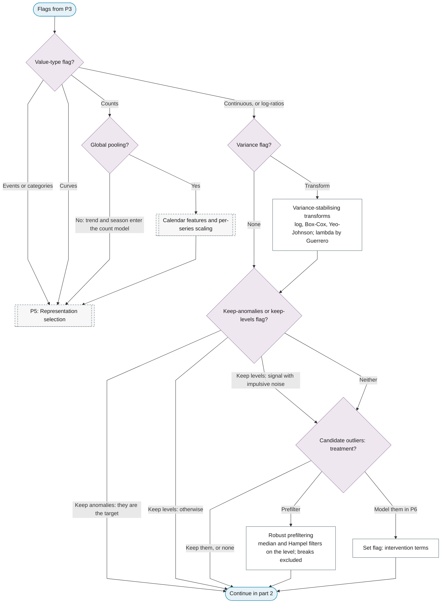
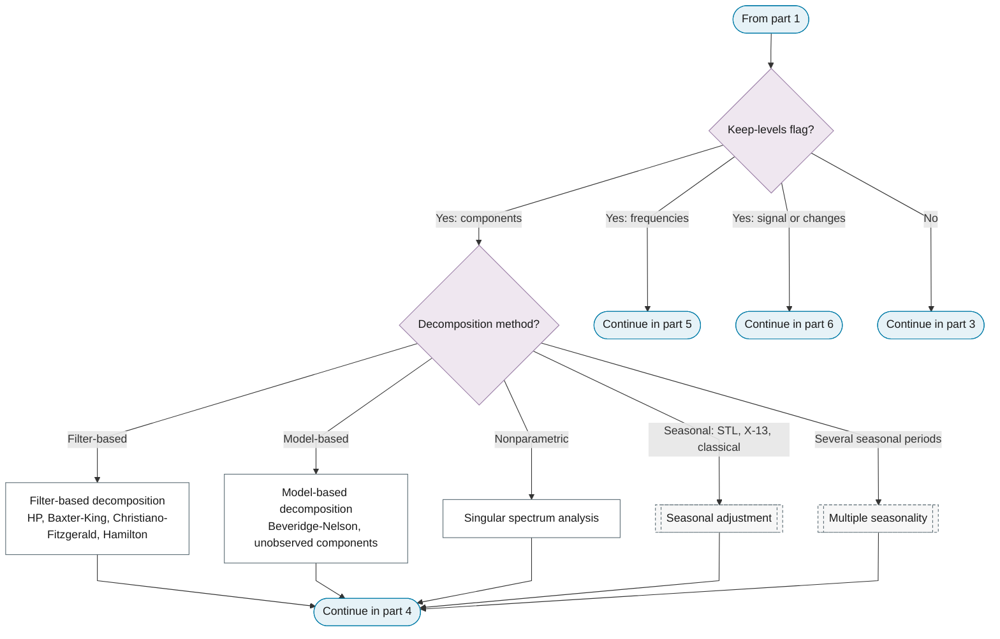
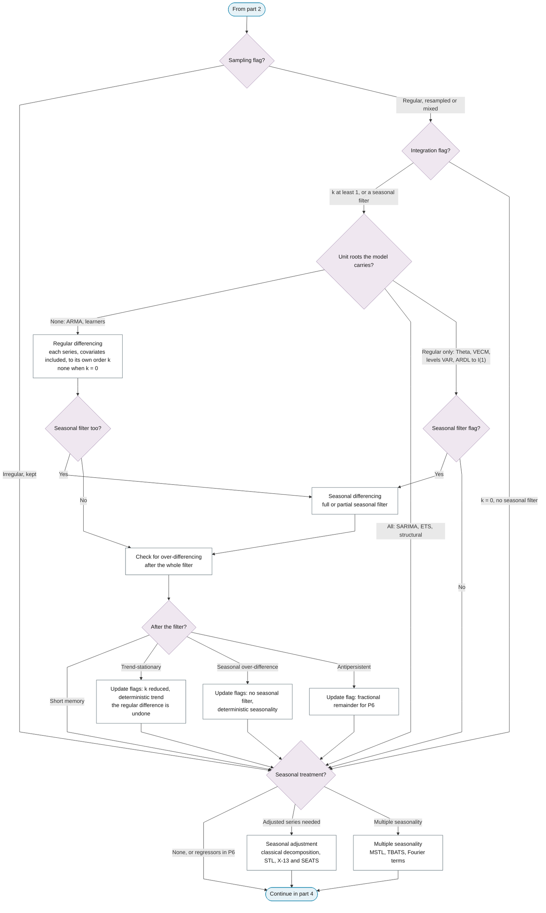
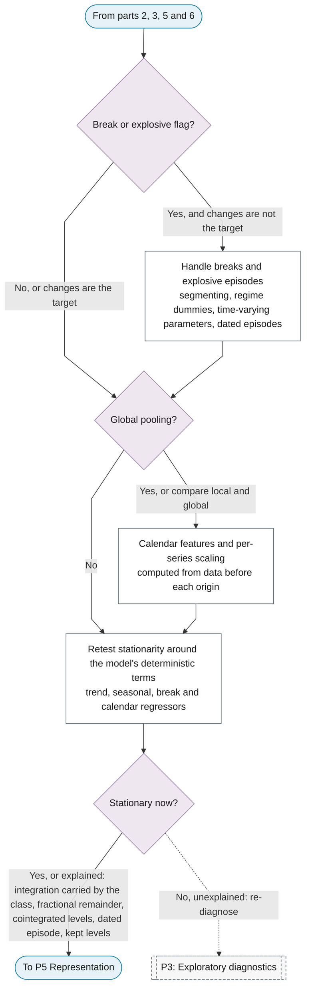
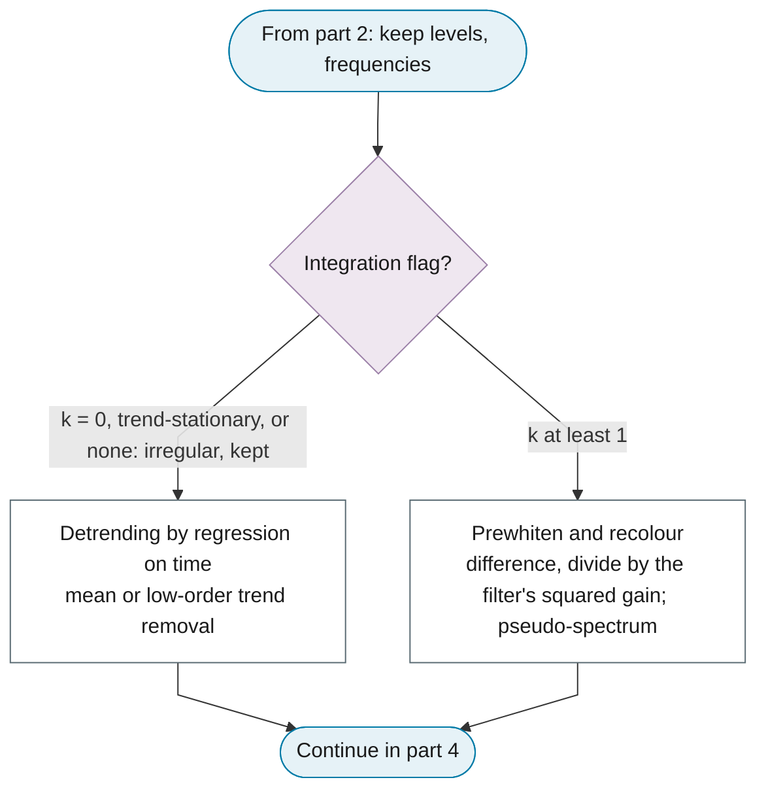
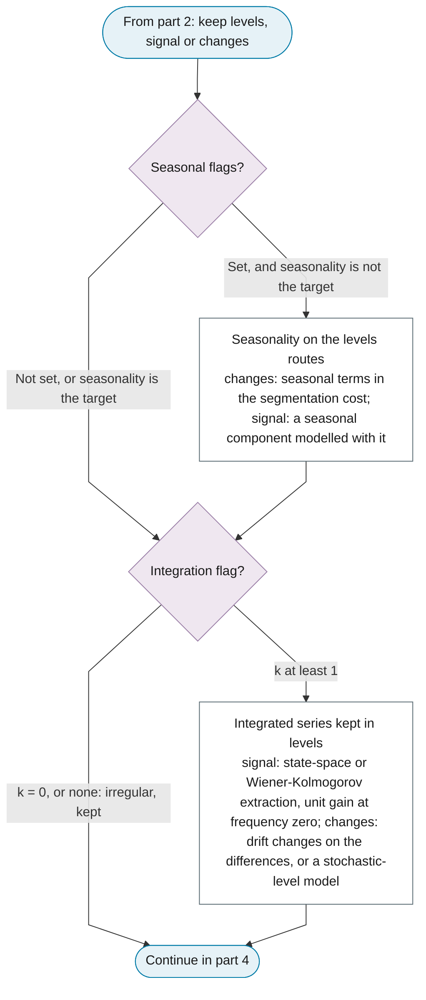

# P4: Transformations

**Question this phase answers:** What must change before modelling, given the purpose and the P3 flags?

Structure the model class will not represent (variance scaling, integration when the class works on differences, breaks) is removed here. Structure the class represents is left for P6: integration carried by an ARIMA-type model, exponential smoothing, Theta, a structural model, a VECM, a VAR in levels or an ARDL, and the deterministic trend, seasonal and calendar regressors. Purposes that study levels keep them: decomposition works on the (log) level, spectral analysis prewhitens and recolours instead of differencing, and change-point detection and signal extraction read the integration flag on their own route instead of differencing; for them the outlier question runs only for signal extraction with impulsive noise, and readers whose target is the anomalies or changes keep them. Decomposition is asked only of readers who want components; readers who keep levels for changes or a signal keep seasonality that is not their target out of it in part 6. Differencing asks which unit roots the model class carries: the regular ones, the seasonal ones too, or none. Compositional series arrive as log-ratios from P3. Counts skip the continuous transforms, event times, categories and curves skip P4, and irregular series skip differencing.

## Sub-diagram

**Part 1: value type, scale and outliers.**

**Part 2: the keep-levels routes, and decomposition on the levels.**

**Part 3: the integration filter and seasonal treatment.**

**Part 4: breaks, features and the retest.**

**Part 5: spectral analysis on levels.**

**Part 6: signal extraction and change points on levels.**

Every two-sided step here (STL, X-13, centred Hampel windows) has a one-sided version, used where the timing flag requires it (see [rolling-origin backtesting](p10-evaluation-selection.md#rolling-origin-backtesting) for the forecaster's case).

## Phase guide

!!! note "Section pending"
    To-do item created from the flowchart inventory (node `P4`). Write this section following the content rules in `.claude/rules/writing.md`.

## Variance-stabilising transforms

!!! note "Section pending"
    To-do item created from the flowchart inventory (node `P4_LOG_BOXCOX`). Write this section following the content rules in `.claude/rules/writing.md`.

## Robust prefiltering

!!! note "Section pending"
    To-do item created from the flowchart inventory (node `P4_ROBUST_PREFILTER`). Write this section following the content rules in `.claude/rules/writing.md`.

## Filter-based decomposition

!!! note "Section pending"
    To-do item created from the flowchart inventory (node `P4_FILTER_DECOMPOSITION`). Write this section following the content rules in `.claude/rules/writing.md`.

## Model-based decomposition

!!! note "Section pending"
    To-do item created from the flowchart inventory (node `P4_MODEL_DECOMPOSITION`). Write this section following the content rules in `.claude/rules/writing.md`.

## Singular spectrum analysis

!!! note "Section pending"
    To-do item created from the flowchart inventory (node `P4_SSA`). Write this section following the content rules in `.claude/rules/writing.md`.

## Regular differencing

!!! note "Section pending"
    To-do item created from the flowchart inventory (node `P4_DIFFERENCE`). Write this section following the content rules in `.claude/rules/writing.md`.

## Seasonal differencing

!!! note "Section pending"
    To-do item created from the flowchart inventory (node `P4_SEASONAL_DIFFERENCE`). Write this section following the content rules in `.claude/rules/writing.md`.

## Check for over-differencing

!!! note "Section pending"
    To-do item created from the flowchart inventory (node `P4_OVERDIFFERENCING`). Write this section following the content rules in `.claude/rules/writing.md`.

## Seasonal adjustment

!!! note "Section pending"
    To-do item created from the flowchart inventory (node `P4_SEASONAL_ADJUSTMENT`). Write this section following the content rules in `.claude/rules/writing.md`.

## Multiple seasonality

!!! note "Section pending"
    To-do item created from the flowchart inventory (node `P4_MULTIPLE_SEASONALITY`). Write this section following the content rules in `.claude/rules/writing.md`.

## Handle breaks and explosive episodes

!!! note "Section pending"
    To-do item created from the flowchart inventory (node `P4_BREAK_HANDLING`). Write this section following the content rules in `.claude/rules/writing.md`.

## Calendar features and per-series scaling

!!! note "Section pending"
    To-do item created from the flowchart inventory (node `P4_FEATURES`). Write this section following the content rules in `.claude/rules/writing.md`.

## Retest stationarity around the model's deterministic terms

!!! note "Section pending"
    To-do item created from the flowchart inventory (node `P4_RETEST`). Write this section following the content rules in `.claude/rules/writing.md`.

## Detrending by regression on time

!!! note "Section pending"
    To-do item created from the flowchart inventory (node `P4_DETREND`). Write this section following the content rules in `.claude/rules/writing.md`.

## Prewhiten and recolour

!!! note "Section pending"
    To-do item created from the flowchart inventory (node `P4_PREWHITEN`). Write this section following the content rules in `.claude/rules/writing.md`.

## Seasonality on the levels routes

!!! note "Section pending"
    To-do item created from the flowchart inventory (node `P4_LEVELS_SEASONALITY`). Write this section following the content rules in `.claude/rules/writing.md`.

## Integrated series kept in levels

!!! note "Section pending"
    To-do item created from the flowchart inventory (node `P4_INTEGRATED_LEVELS`). Write this section following the content rules in `.claude/rules/writing.md`.
