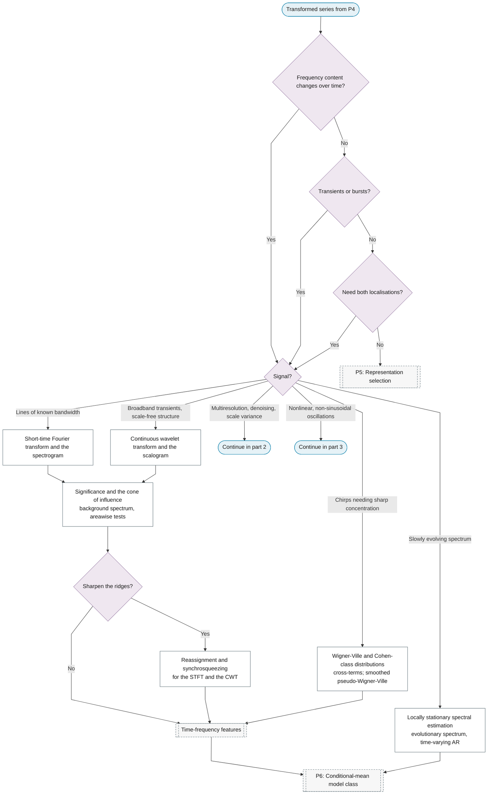
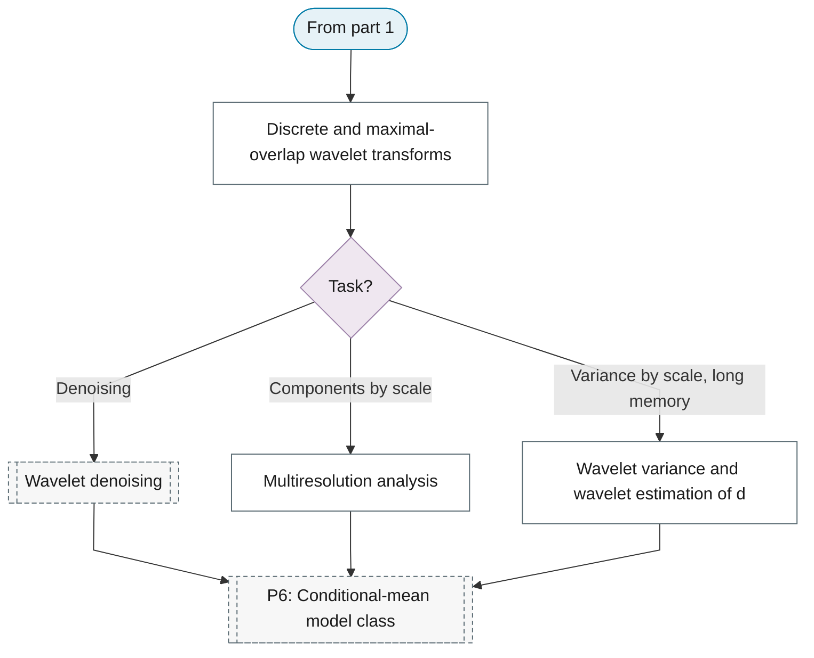
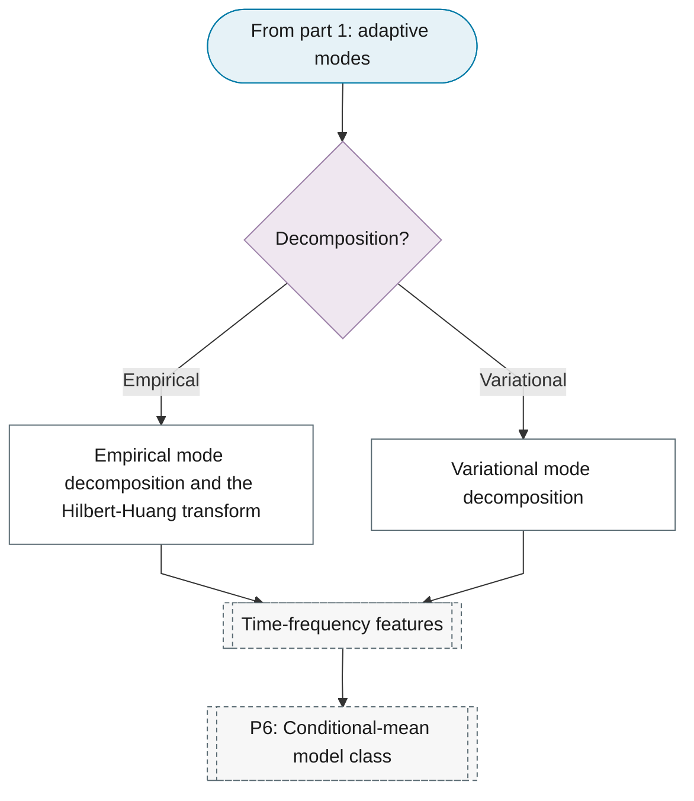

# Representation 3: Time-frequency

**Best for:** Non-stationary signals, transients and evolving spectra.

## Sub-chart

**Part 1: the transform for the signal.**

**Part 2: discrete wavelet tasks.**

**Part 3: adaptive modes.**

