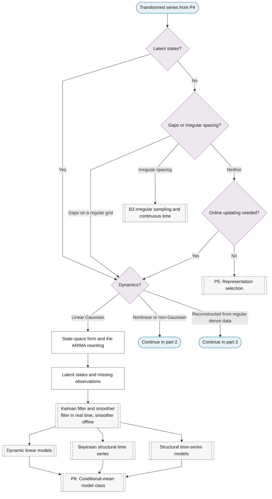
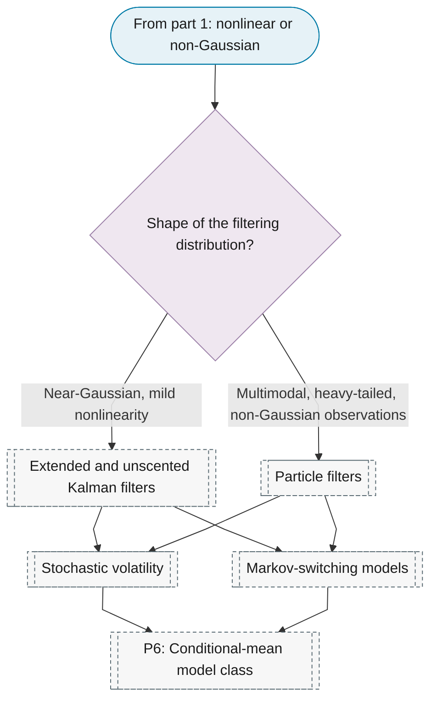
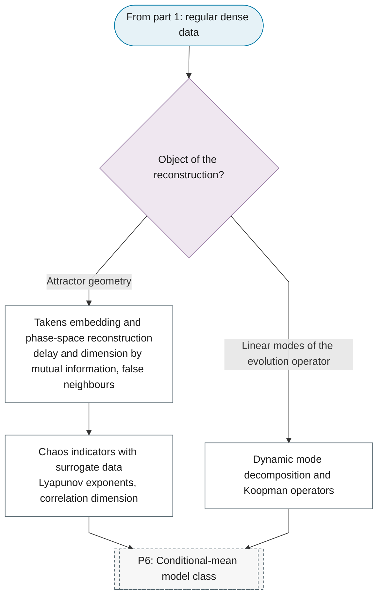

# Representation 4: State space

**Best for:** Latent states, irregular sampling, missing observations and online updating.

## Sub-chart

**Part 1: latent states and the linear Gaussian filter.**

**Part 2: nonlinear and non-Gaussian filtering.**

**Part 3: dynamics reconstructed from dense data.**

