# P6: Conditional-mean model class

**Question this phase answers:** Which family describes the mean?

P6 reads the value type and the structure first: counts and categories, event times, curves, wide panels and spatial or network data continue in the P6 part of their branch chart, and a deliverable that is no conditional-mean model goes to its purpose chart (part 12) and then to P10. For continuous and compositional series P6 reads the pooling, mixed-frequency and structure flags to choose a route, then the family on that route: linear, long memory, smoothing, periodic and intermittent for one series; VAR, VECM and ADL for a few related series; factor, shrinkage and graphical models for many variables; nonlinear, time-varying and latent-component, input-output, and learner families. Covariates, intervention terms and deterministic regressors are read after the family, because every family can carry them. The first question has answer No when the deliverable is a component, a filtered signal, a spectrum, a classifier, a detector, a segmentation or a resampled path; state-space smoothing, regime switching and residual-based detection fit a model, so their answer is Yes. P6 can emit several candidates (for example a local ETS and a global gradient-boosting model); each passes P7 to P9 and meets the P0 baselines in P10.

## Sub-diagram

**Part 1: routing on the value type and the structure.**

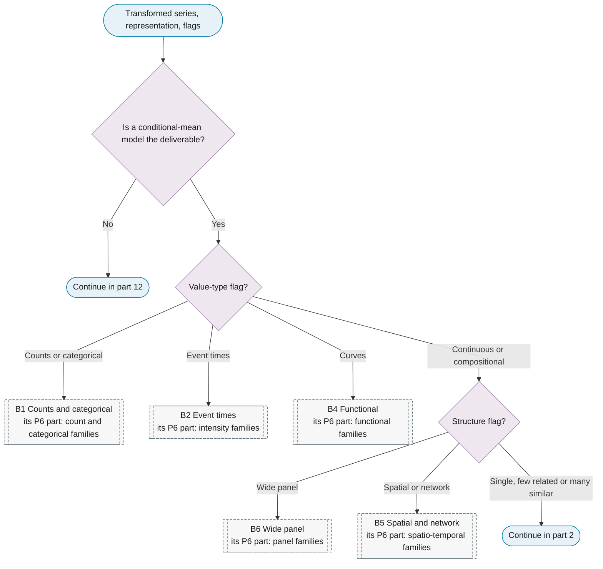

**Part 2: routing on the pooling, mixed-frequency and structure flags.**

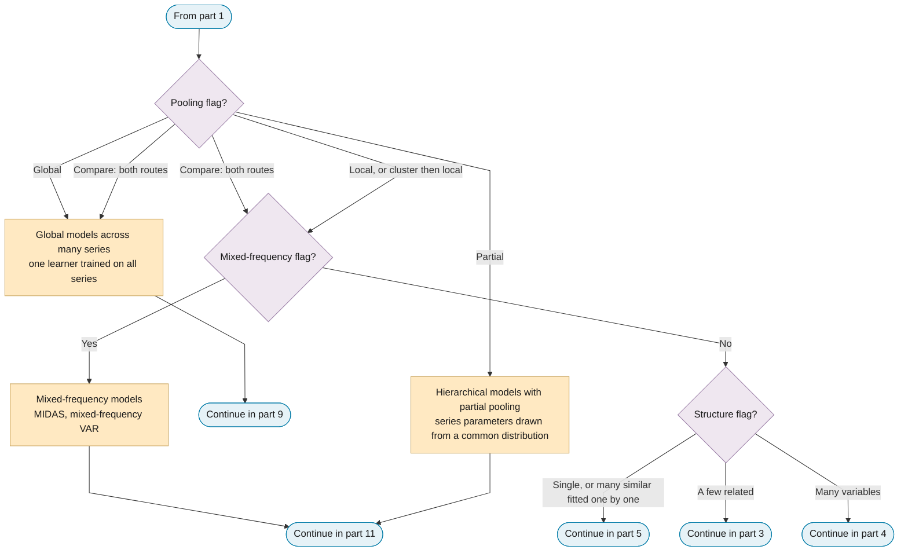

**Part 3: a few related series.**

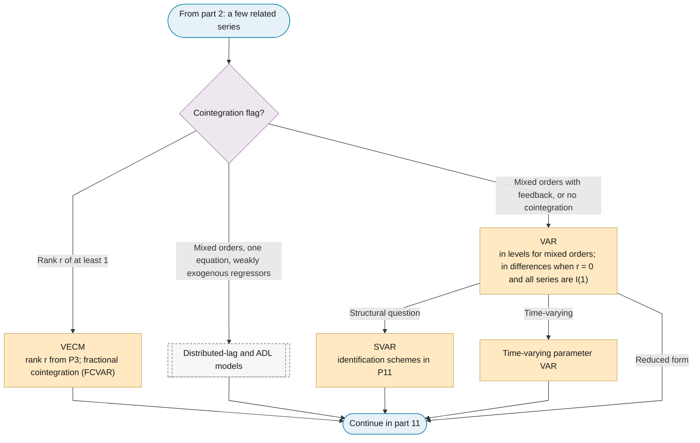

**Part 4: many variables.**

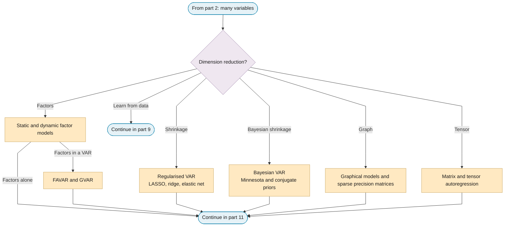

**Part 5: one series, and its linear families.**

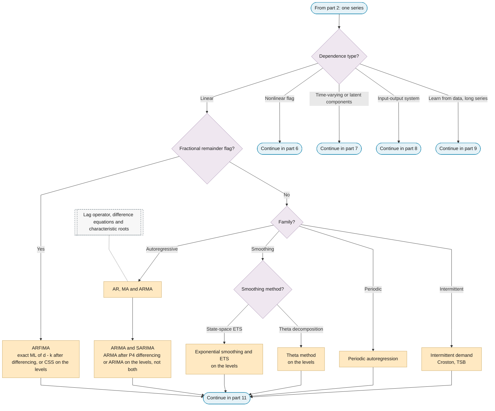

**Part 6: nonlinear families.**

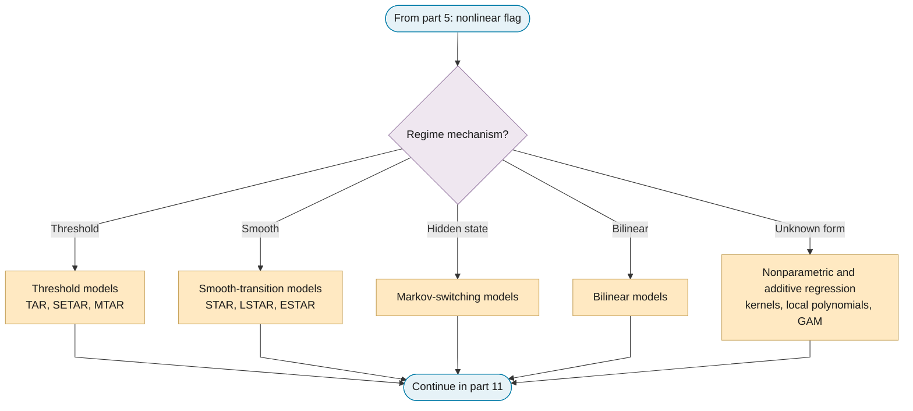

**Part 7: time-varying and latent-component families.**

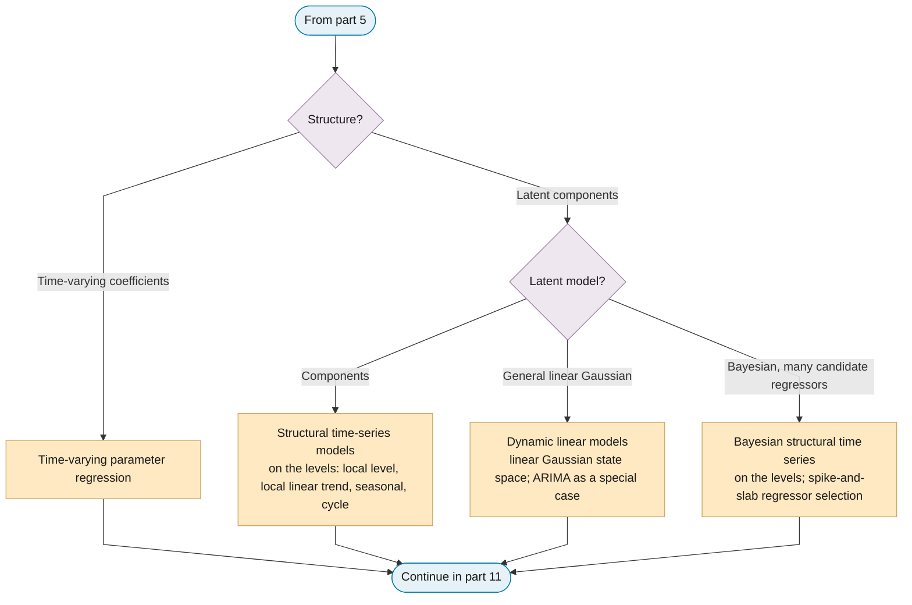

**Part 8: input-output systems.**

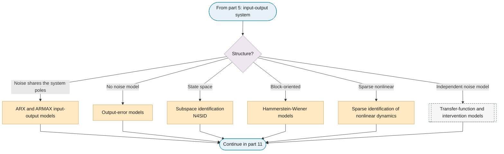

**Part 9: learners: multi-step strategy, then classical, pretrained or generative, and hybrid.**

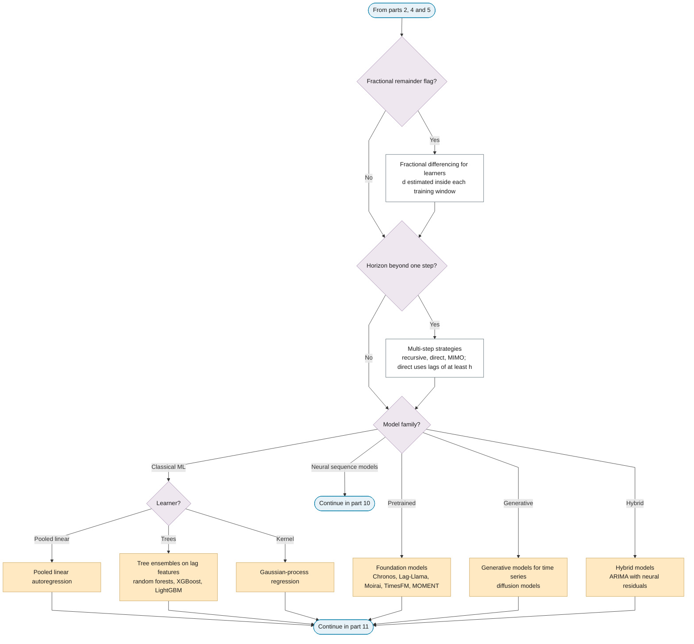

**Part 10: neural sequence models.**

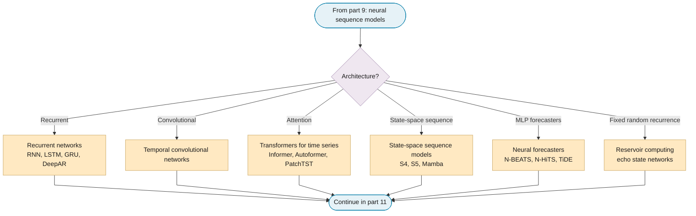

**Part 11: terms every family can carry, model kind and the candidate set.**

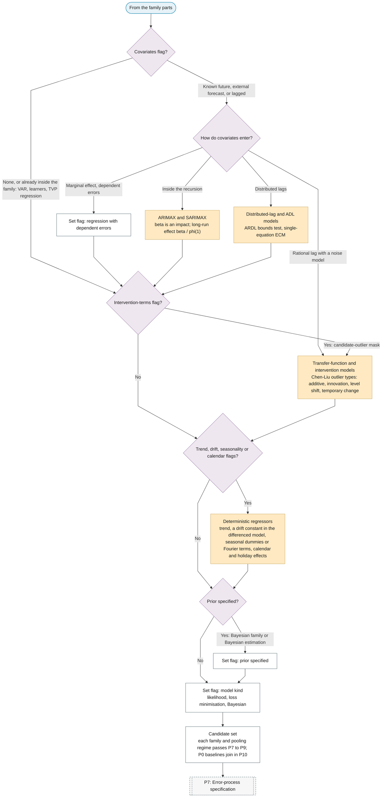

**Part 12: routes that fit no conditional-mean model.**

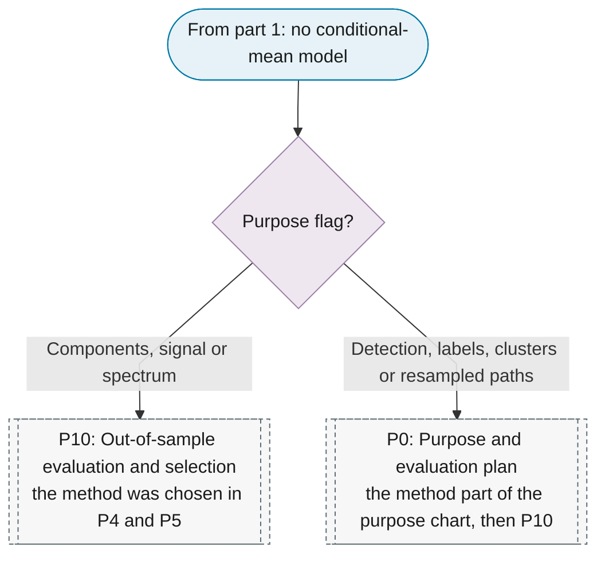

## Phase guide

!!! note "Section pending"
    To-do item created from the flowchart inventory (node `P6`). Write this section following the content rules in `.claude/rules/writing.md`.

## Candidate set

!!! note "Section pending"
    To-do item created from the flowchart inventory (node `P6_CANDIDATE_SET`). Write this section following the content rules in `.claude/rules/writing.md`.
