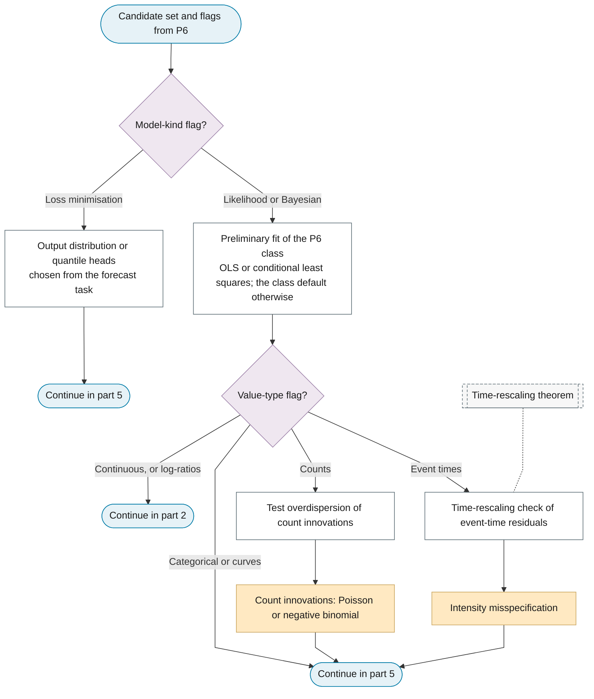
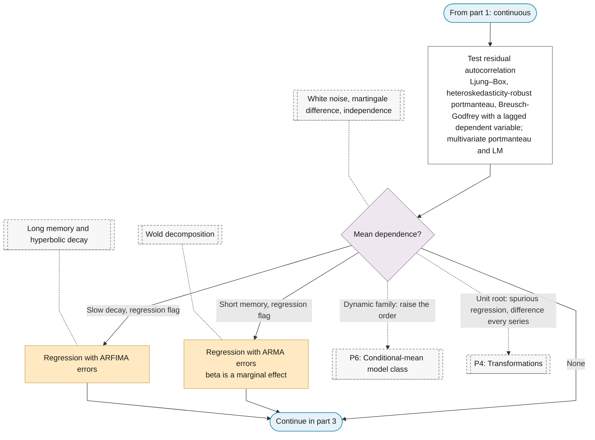
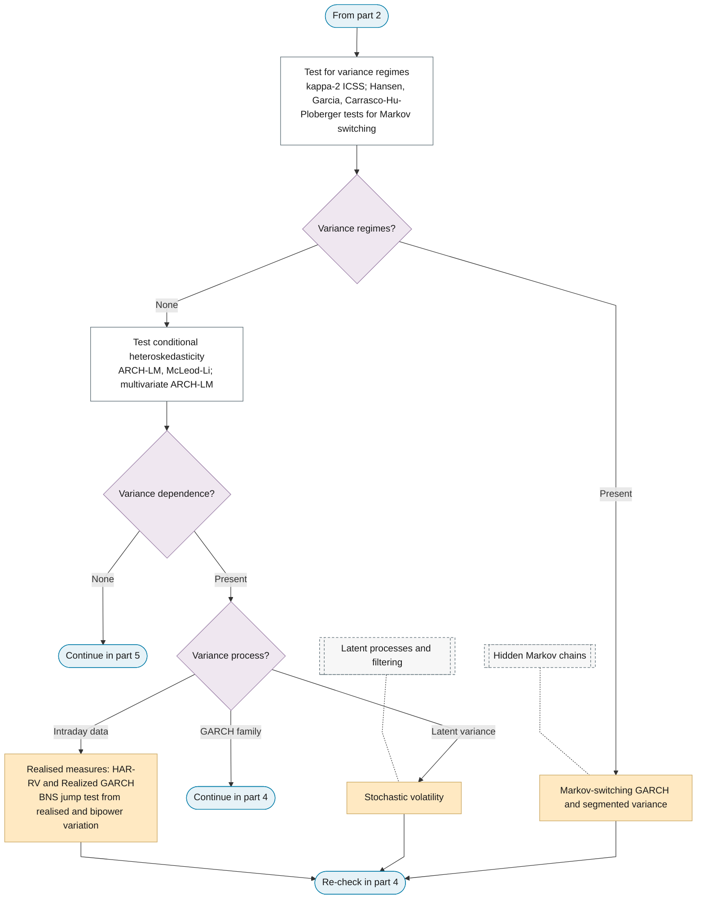
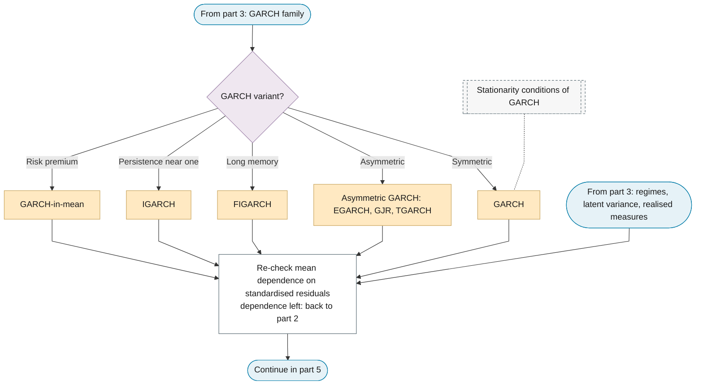
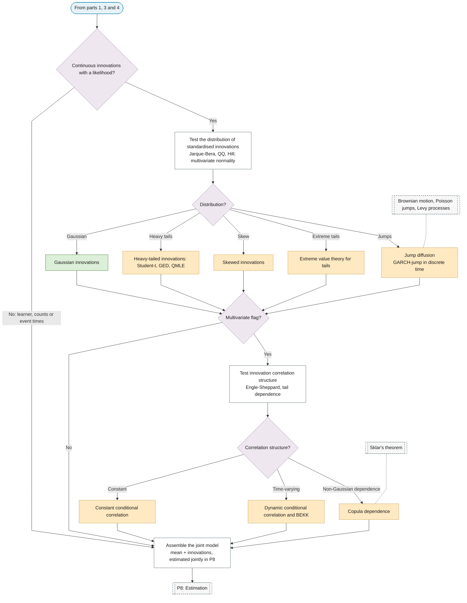

# P7: Error-process specification

**Question this phase answers:** What process do the innovations follow?

P7 reads the model-kind flag first. A learner fitted by loss minimisation gets an output distribution or quantile heads chosen from the forecast task, because it has no likelihood for a variance model to enter. A likelihood or Bayesian model is fitted once by the class's default consistent method (OLS or conditional least squares for linear classes), because residuals exist only after a fit; the error questions are asked on those residuals: remaining mean dependence, variance regimes, conditional heteroskedasticity, distribution, cross-series dependence, and the count and event-time variants. The output is a joint model that P8 estimates jointly, usually by maximum likelihood; feasible GLS (Cochrane-Orcutt, Prais-Winsten) is the classical approximation for AR(p) errors with strictly exogenous regressors, and fitting ARMA to OLS residuals and stopping leaves the regression coefficients at their OLS values.

## Sub-diagram

The order of the questions is a derivation chain: each step's test assumes the previous step's structure has been removed. Portmanteau tests are oversized under conditional heteroskedasticity, so step 1 uses heteroskedasticity-robust versions and is re-run on standardised residuals after the variance model. Variance regimes are tested before the GARCH variant, because a neglected break in the unconditional variance pushes estimated GARCH persistence towards one and makes squared residuals decay slowly. Distribution tests run on standardised residuals and assume the variance model is fixed; correlation tests run on each series' standardised residuals.

**Part 1: model kind, preliminary fit and value type.**

**Part 2: mean dependence.**

**Part 3: variance regimes, then conditional variance.**

**Part 4: GARCH variant and the re-check on standardised residuals.**

**Part 5: distribution, correlation and assembly.**

## Question order

| Step | Question | Tests | Branches |
|---|---|---|---|
| 0 | Model kind and value type? | Overdispersion tests for counts; time-rescaling KS test for event times | Loss minimisation: output distribution or quantile heads. Likelihood or Bayesian: preliminary fit, then the value type: continuous or compositional to step 1; counts to Poisson or negative-binomial innovations; event times to intensity misspecification; categorical series and curves to their branch model |
| 1 | Mean dependence left? | Ljung–Box, heteroskedasticity-robust portmanteau, Breusch-Godfrey with a lagged dependent variable; multivariate portmanteau and LM | None: step 2. Short memory with the regression flag: ARMA errors. Slow decay with the regression flag: ARFIMA errors. Dynamic family still dependent: back to P6. Unit root in the residuals: spurious regression; difference every series in P4 |
| 2 | Variance regimes? | kappa-2 ICSS; Hansen, Garcia and Carrasco-Hu-Ploberger tests for Markov switching | Present: MS-GARCH or segmented variance. None: step 3 |
| 3 | Second-moment dependence? | ARCH-LM, McLeod-Li, squared-residual ACF; multivariate ARCH-LM | None: step 4. Present: GARCH; EGARCH / GJR / TGARCH; FIGARCH or IGARCH, reachable only after step 2 ruled out regimes; GARCH-in-mean; stochastic volatility; HAR-RV / Realized GARCH with intraday data. Then step 1 again on standardised residuals |
| 4 | Distribution of standardised innovations? | Jarque-Bera, QQ, Hill tail index; multivariate normality | Gaussian; Student-t / GED or QMLE; skewed-t; EVT; jumps |
| 5 | Several series? | Engle-Sheppard constant-correlation test, tail dependence | CCC; DCC / BEKK; copula |

Terminals name **model → estimator → inference**; for example, regression + ARMA errors + GARCH-t → joint MLE → asymptotic-normal standard errors.

## Part 0 hooks

| Branch | Stochastic-process concept | Chain link |
|---|---|---|
| White noise terminal | White noise, martingale difference, independence | Ljung–Box tests uncorrelatedness only; ARCH errors are a martingale difference with dependent squares |
| ARMA errors | Wold decomposition | Any purely non-deterministic covariance-stationary process is MA(∞) in its white-noise linear innovations; ARMA is a rational approximation of that MA(∞) |
| ARFIMA errors | Long memory, hyperbolic decay | Why no finite-order ARMA reproduces it |
| GARCH | Weak stationarity α + β < 1; strict stationarity E[log(α z² + β)] < 0 | IGARCH is strictly stationary with infinite unconditional variance |
| Stochastic volatility | Latent process, filtering | Why the likelihood has no closed form |
| Jump diffusion | Brownian motion, Poisson jumps, Levy processes | Quadratic variation splits into continuous and jump parts |
| Markov switching | Hidden Markov chain | Hamilton filter |
| Event times | Conditional intensity, time-rescaling theorem | Under the true intensity, rescaled event times form a unit Poisson process |
| Copula | Sklar's theorem | Marginals and dependence separate |

## Relation to P9

P7 is specified once. After joint estimation in P8, P9 re-runs steps 0 to 5 on the complete model. A failed check goes to the P9 purpose gate, which keeps forecasting, detection and collection candidates for P10 and sends the other purposes back to P3, P4, P6 or P7.

## Preliminary fit of the P6 class

!!! note "Section pending"
    To-do item created from the flowchart inventory (node `P7_PRELIM_FIT`). Write this section following the content rules in `.claude/rules/writing.md`.

## Test overdispersion of count innovations

!!! note "Section pending"
    To-do item created from the flowchart inventory (node `P7_COUNT_TESTS`). Write this section following the content rules in `.claude/rules/writing.md`.

## Time-rescaling check of event-time residuals

!!! note "Section pending"
    To-do item created from the flowchart inventory (node `P7_RESCALING`). Write this section following the content rules in `.claude/rules/writing.md`.

## Test residual autocorrelation

!!! note "Section pending"
    To-do item created from the flowchart inventory (node `P7_MEAN_TESTS`). Write this section following the content rules in `.claude/rules/writing.md`.

## Test for variance regimes

!!! note "Section pending"
    To-do item created from the flowchart inventory (node `P7_REGIME_TESTS`). Write this section following the content rules in `.claude/rules/writing.md`.

## Test conditional heteroskedasticity

!!! note "Section pending"
    To-do item created from the flowchart inventory (node `P7_VAR_TESTS`). Write this section following the content rules in `.claude/rules/writing.md`.

## Re-check mean dependence on standardised residuals

!!! note "Section pending"
    To-do item created from the flowchart inventory (node `P7_STD_RECHECK`). Write this section following the content rules in `.claude/rules/writing.md`.

## Test the distribution of standardised innovations

!!! note "Section pending"
    To-do item created from the flowchart inventory (node `P7_DIST_TESTS`). Write this section following the content rules in `.claude/rules/writing.md`.

## Test innovation correlation structure

!!! note "Section pending"
    To-do item created from the flowchart inventory (node `P7_CORR_TESTS`). Write this section following the content rules in `.claude/rules/writing.md`.

## Assemble the joint model

!!! note "Section pending"
    To-do item created from the flowchart inventory (node `P7_OUT`). Write this section following the content rules in `.claude/rules/writing.md`.
