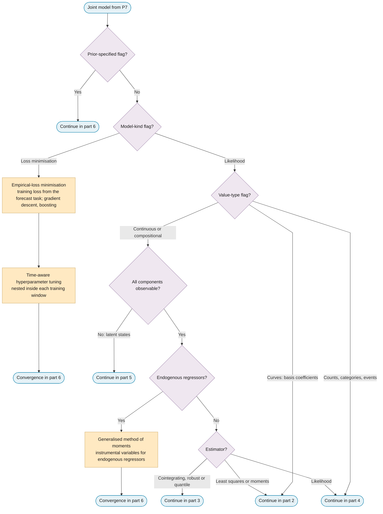
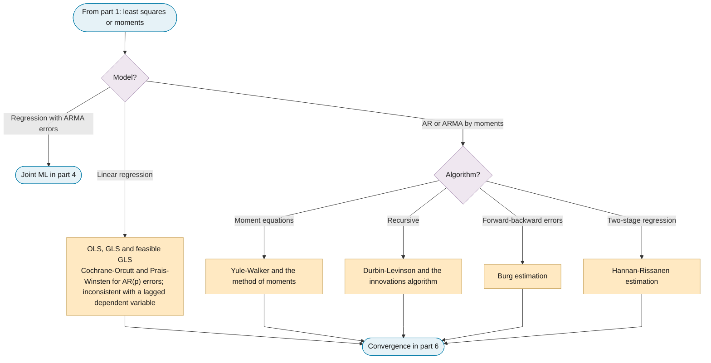
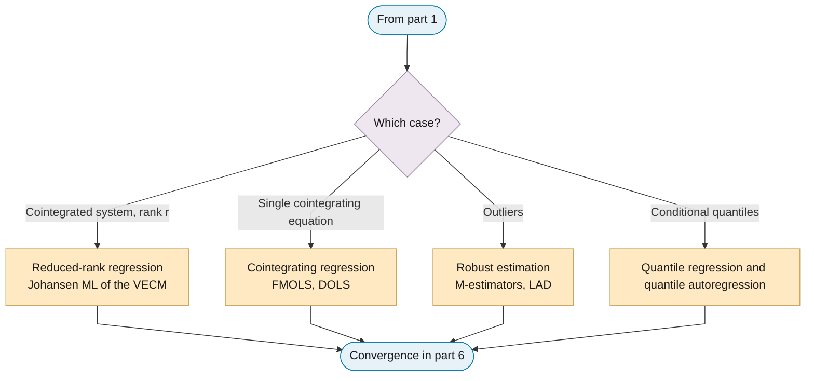
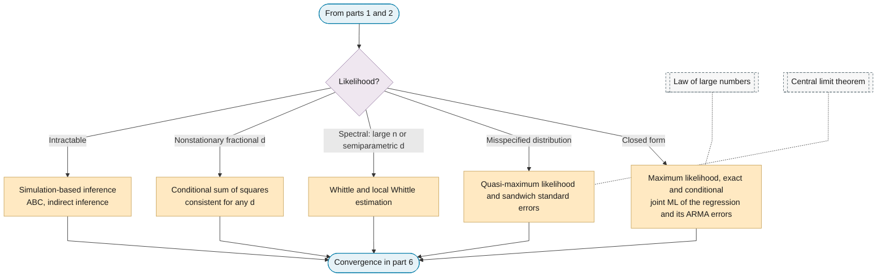
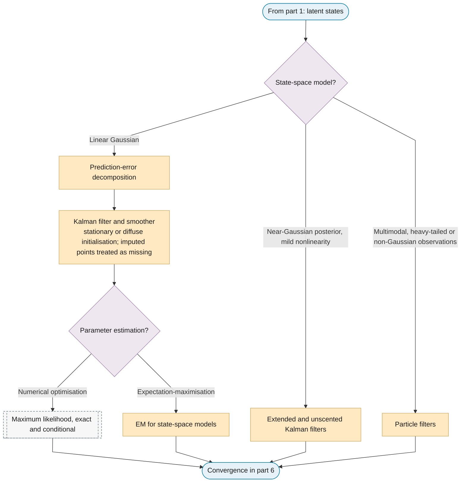
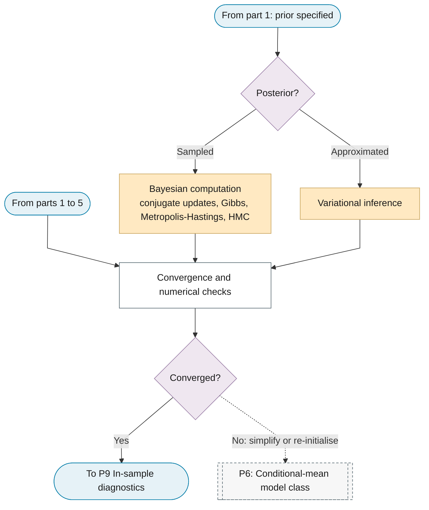

# P8: Estimation

**Question this phase answers:** How are parameters obtained?

P8 reads the prior-specified and model-kind flags first, because Bayesian inference and loss minimisation are choices of paradigm made before any question about tractability. A likelihood model then asks whether every component is observable and whether a regressor is endogenous, because latent states need a filter and an endogenous regressor makes least squares inconsistent. The remaining routes are least squares and moments, cointegrating, robust and quantile regression, and likelihood (exact, conditional, quasi, spectral, conditional sum of squares, simulation-based). Every route ends in the convergence and numerical checks.

## Sub-diagram

**Part 1: prior, model kind, observability and endogeneity.**

**Part 2: least squares and moment estimators.**

**Part 3: cointegrating, robust and quantile regression.**

**Part 4: likelihood.**

**Part 5: latent states.**

**Part 6: Bayesian computation and convergence.**

## Phase guide

!!! note "Section pending"
    To-do item created from the flowchart inventory (node `P8`). Write this section following the content rules in `.claude/rules/writing.md`.

## Convergence and numerical checks

!!! note "Section pending"
    To-do item created from the flowchart inventory (node `P8_CONVERGENCE`). Write this section following the content rules in `.claude/rules/writing.md`.
