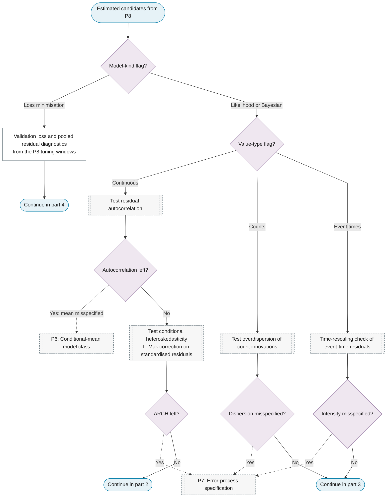
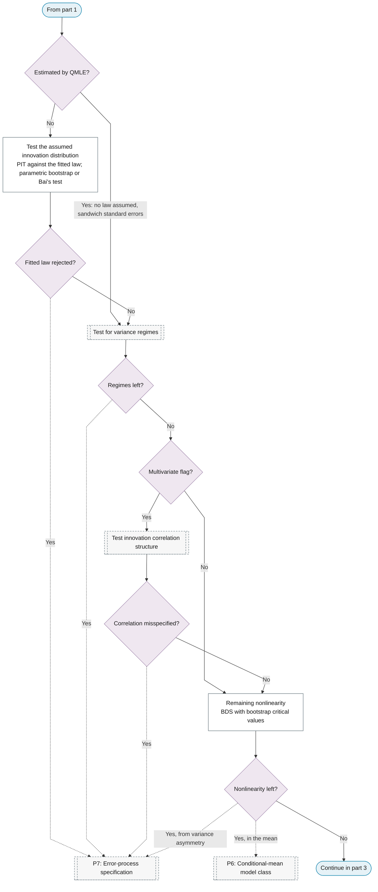
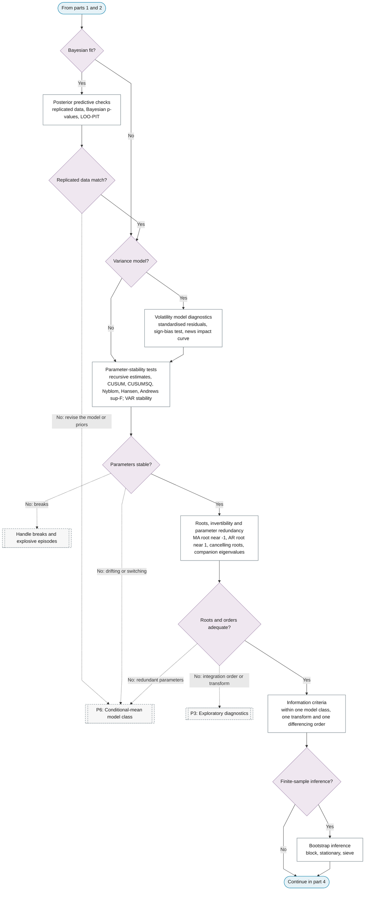
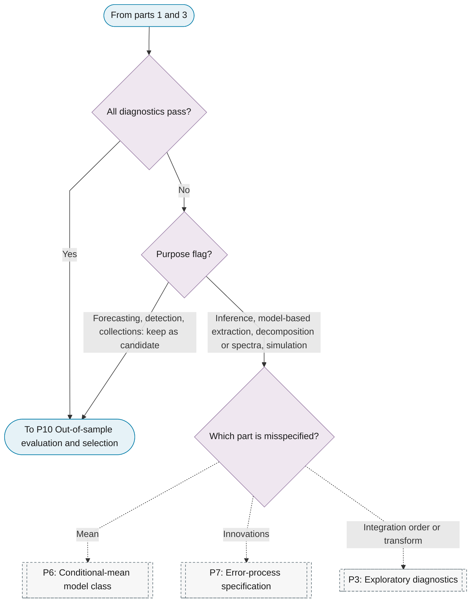

# P9: In-sample diagnostics

**Question this phase answers:** Does the fitted model hold up?

P9 reads the model kind first: a learner is checked by its validation loss from the P8 tuning windows and by pooled residual diagnostics, because a loss-minimisation fit has no likelihood and per-series tests on thousands of residual series are a multiple-testing exercise. A likelihood or Bayesian fit re-runs the P7 tests on the complete model with the corrections that estimated parameters require (Li-Mak for squared standardised residuals, bootstrap critical values for BDS, probability integral transforms against the fitted law), then checks parameter stability, roots and parameter redundancy, and compares information criteria within one model class, one transform and one differencing order. Forecast comparison and encompassing belong to P10, because they need out-of-sample errors.

What a failed diagnostic triggers depends on the purpose. The outputs of inference purposes, model-based extraction, decomposition and spectra, and simulation from a fitted model are valid only under the fitted model, so a failure loops back. Forecasting, detection and collections judge candidates out of sample, so a failure is an improvement signal and the candidate stays in the comparison set. Routes that fit no model do not pass P9.

## Sub-diagram

**Part 1: model kind, value type, mean and variance re-tests.**

**Part 2: distribution, regimes, correlation and nonlinearity.**

**Part 3: Bayesian and volatility checks, stability, roots and information criteria.**

**Part 4: the gate, by purpose.**

## Phase guide

!!! note "Section pending"
    To-do item created from the flowchart inventory (node `P9`). Write this section following the content rules in `.claude/rules/writing.md`.

## Test the assumed innovation distribution

!!! note "Section pending"
    To-do item created from the flowchart inventory (node `P9_DIST_FIT`). Write this section following the content rules in `.claude/rules/writing.md`.

## Remaining nonlinearity

!!! note "Section pending"
    To-do item created from the flowchart inventory (node `P9_RESIDUAL_NONLINEARITY`). Write this section following the content rules in `.claude/rules/writing.md`.

## Posterior predictive checks

!!! note "Section pending"
    To-do item created from the flowchart inventory (node `P9_POSTERIOR_PREDICTIVE`). Write this section following the content rules in `.claude/rules/writing.md`.

## Volatility model diagnostics

!!! note "Section pending"
    To-do item created from the flowchart inventory (node `P9_VOLATILITY_DIAGNOSTICS`). Write this section following the content rules in `.claude/rules/writing.md`.

## Parameter-stability tests

!!! note "Section pending"
    To-do item created from the flowchart inventory (node `P9_STABILITY`). Write this section following the content rules in `.claude/rules/writing.md`.

## Roots, invertibility and parameter redundancy

!!! note "Section pending"
    To-do item created from the flowchart inventory (node `P9_ROOTS`). Write this section following the content rules in `.claude/rules/writing.md`.
