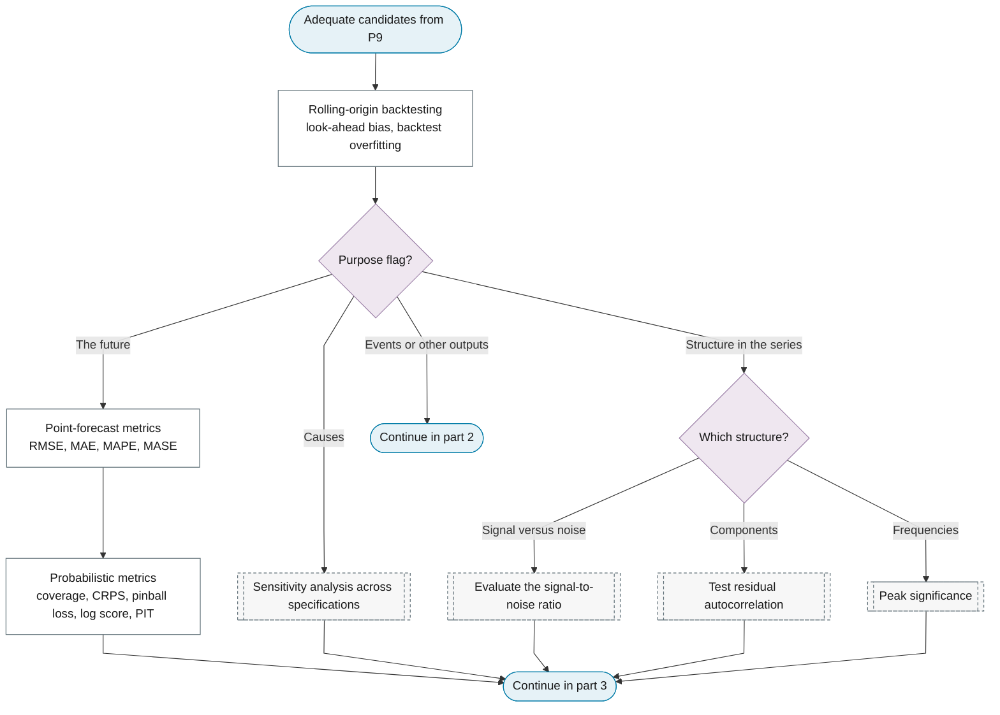
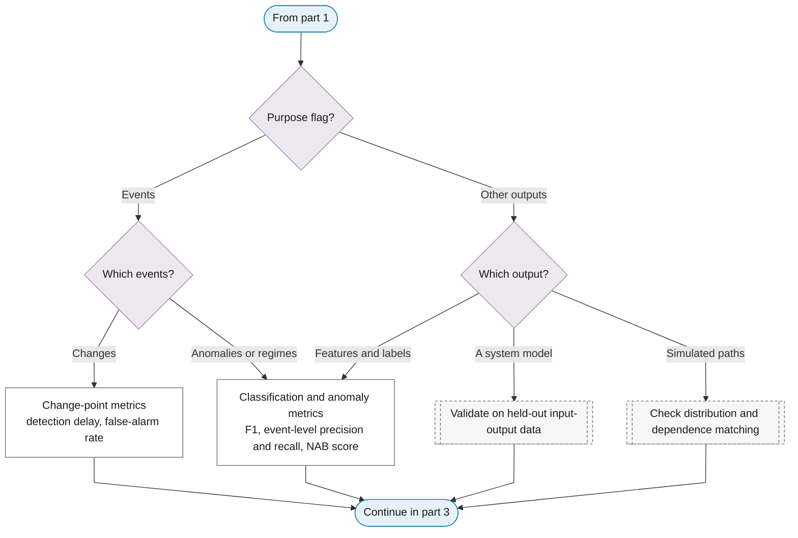
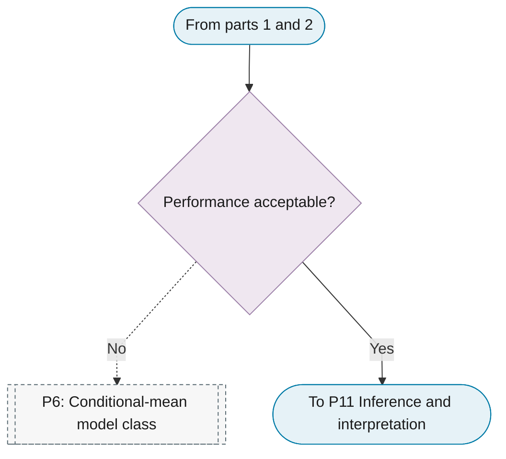

# P10: Out-of-sample evaluation and selection

**Question this phase answers:** Which candidate predicts or detects best on data it has not seen?

Rolling-origin validation and backtesting, purpose-specific metrics, and the acceptance decision.

## Sub-diagram

**Part 1: backtesting and metrics for the future, causes and structure.**

**Part 2: metrics for events and other outputs.**

**Part 3: acceptance.**

## Phase guide

!!! note "Section pending"
    To-do item created from the flowchart inventory (node `P10`). Write this section following the content rules in `.claude/rules/writing.md`.

## Rolling-origin backtesting

!!! note "Section pending"
    To-do item created from the flowchart inventory (node `P10_ROLLING_ORIGIN`). Write this section following the content rules in `.claude/rules/writing.md`.
