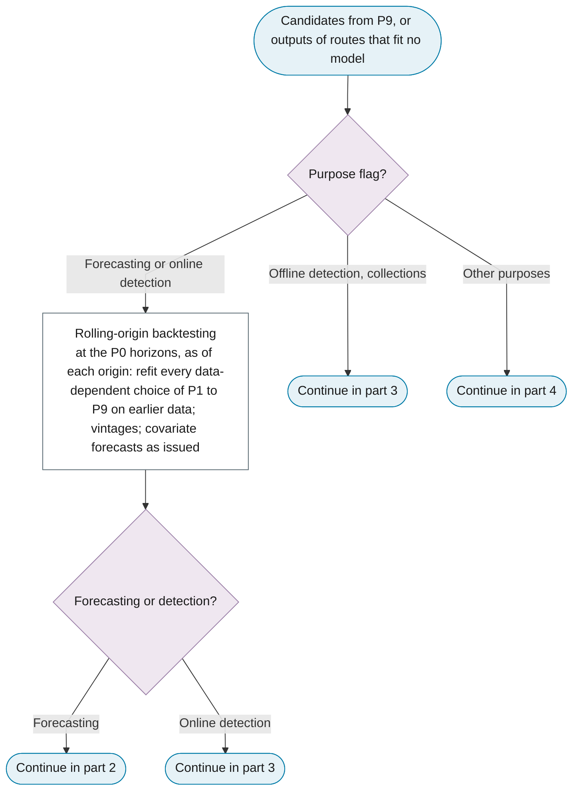
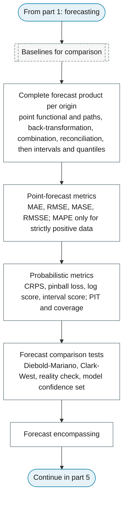
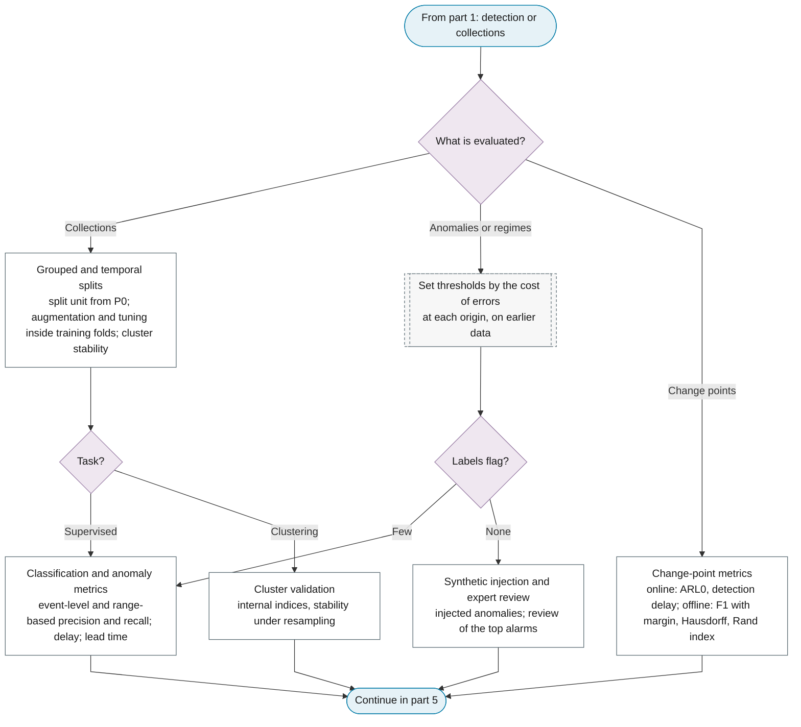
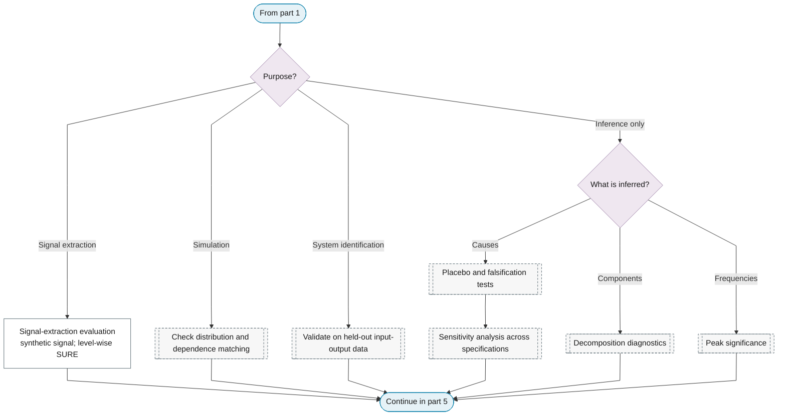
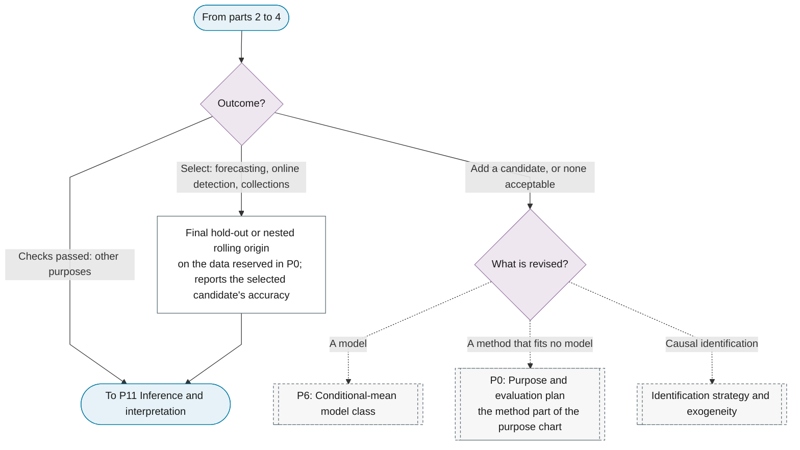

# P10: Out-of-sample evaluation and selection

**Question this phase answers:** Which candidate, or baseline, predicts or detects best on data it has not seen?

P10 is an as-of-origin simulation for forecasting and online detection. At each origin, every data-dependent choice of P1 to P9 is refitted on the data before the origin (imputation, clustering, break dates and the integration, seasonal and cointegration verdicts, the variance transform, d, decomposition, seasonal adjustment, features and scaling, model orders, the error specification, tuning and information-criterion selection), because a choice fitted on the full sample leaks the future into the evaluation. The final hold-out reserved in P0 is touched by no phase before P10. Data enter as they stood at the origin (vintages, right-truncated counts when the reporting-delay flag is set), covariates that are external forecasts enter as issued, and the refit cadence and window type match the retraining policy of P12. A forecaster scores the complete product it will issue, on the target scale against raw actuals, with the P0 baselines in the comparison set. The selected candidate's accuracy is reported on data the selection never saw. Documentation and the retraining policy follow in [P12](p12-deployment-monitoring.md).

## Sub-diagram

**Part 1: the as-of-origin simulation and the purpose routes.**

**Part 2: forecasting.**

**Part 3: detection and collections.**

**Part 4: signal extraction, simulation, system identification and inference-only purposes.**

**Part 5: selection and exits.**

## Phase guide

!!! note "Section pending"
    To-do item created from the flowchart inventory (node `P10`). Write this section following the content rules in `.claude/rules/writing.md`.

## Rolling-origin backtesting

!!! note "Section pending"
    To-do item created from the flowchart inventory (node `P10_ROLLING_ORIGIN`). Write this section following the content rules in `.claude/rules/writing.md`.

## Complete forecast product per origin

!!! note "Section pending"
    To-do item created from the flowchart inventory (node `P10_FORECAST_PRODUCT`). Write this section following the content rules in `.claude/rules/writing.md`.

## Final hold-out or nested rolling origin

!!! note "Section pending"
    To-do item created from the flowchart inventory (node `P10_FINAL_HOLDOUT`). Write this section following the content rules in `.claude/rules/writing.md`.
