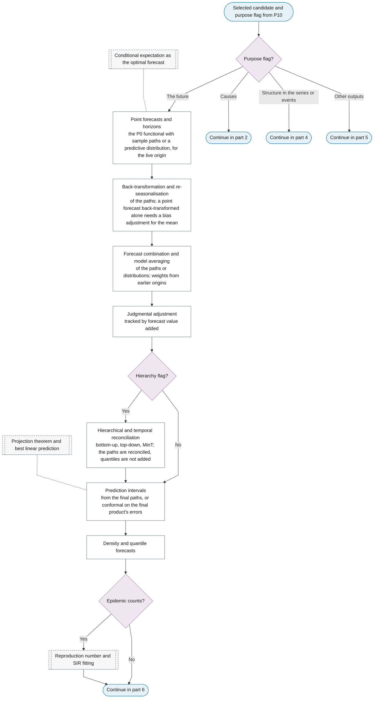
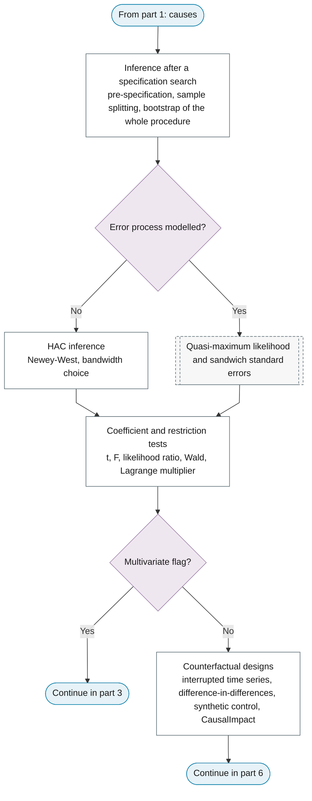
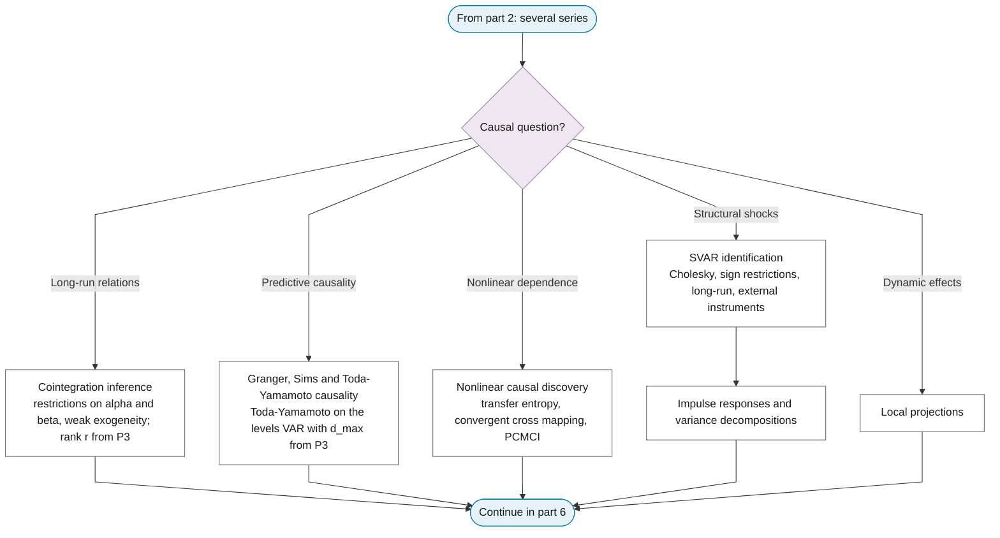
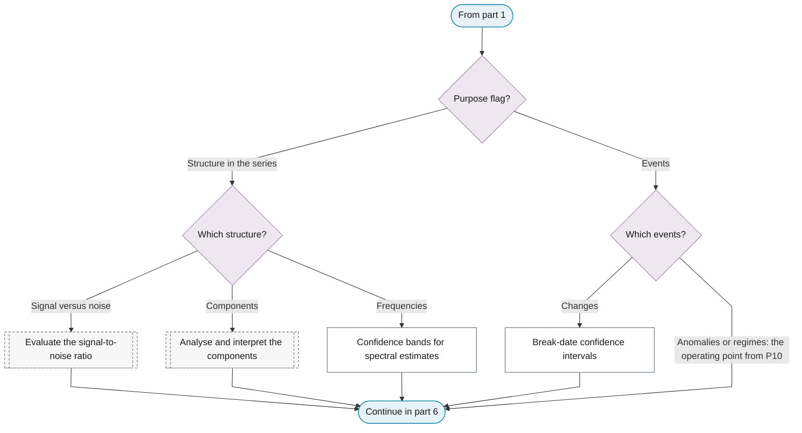
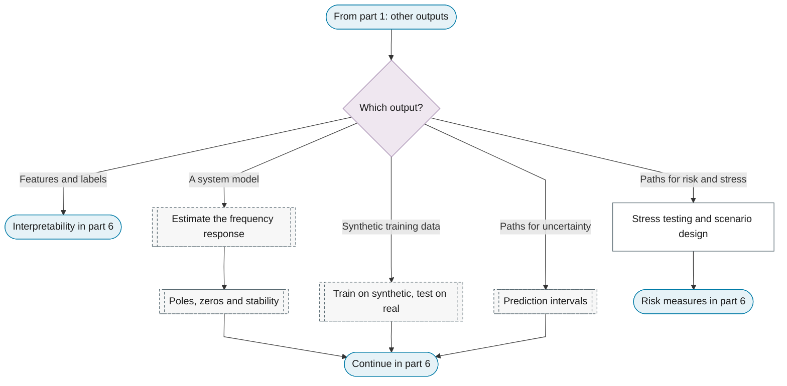
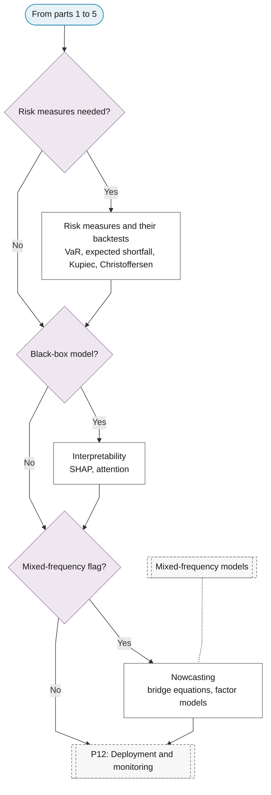

# P11: Inference and interpretation

**Question this phase answers:** What does the selected model say, for this purpose?

P11 issues and interprets the output of the candidate selected in P10. A forecaster issues, for the live origin, the same product P10 scored, built on sample paths or predictive distributions: back-transformation and re-seasonalisation to the target scale, combination, judgmental adjustment and reconciliation act on the paths, and intervals and quantiles are derived last. The order follows from two facts: aggregation constraints are linear on the target scale, and quantiles are not additive, so intervals computed before combination and reconciliation would surround a different centre. Causal and structural inference accounts for the specification search that produced the model. Structure, events and other outputs are interpreted with their uncertainty: confidence bands for spectra, confidence intervals for break dates.

## Sub-diagram

**Part 1: dispatch on the purpose flag, and forecasting.**

**Part 2: causal and structural inference.**

**Part 3: causal questions for several series.**

**Part 4: structure in the series and events.**

**Part 5: other outputs.**

**Part 6: risk measures, interpretability and nowcasting.**

## Phase guide

!!! note "Section pending"
    To-do item created from the flowchart inventory (node `P11`). Write this section following the content rules in `.claude/rules/writing.md`.
