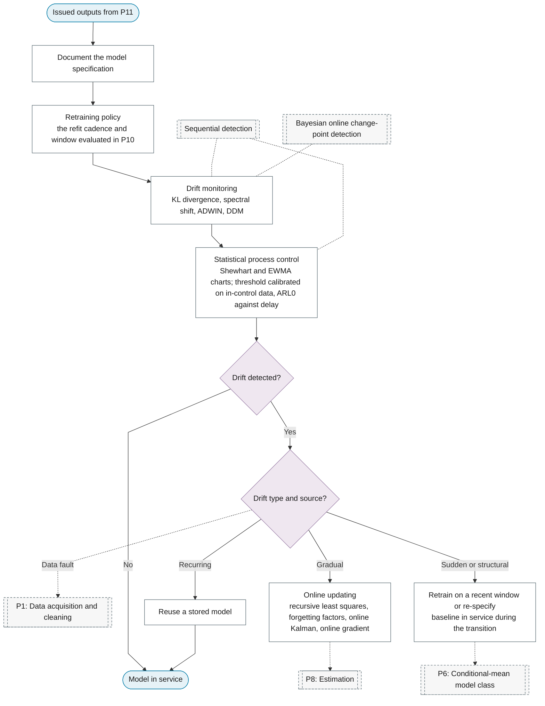

# P12: Deployment and monitoring

**Question this phase answers:** Does the deployed model keep working?

Documentation, the retraining policy, drift monitoring and statistical process control, and a response chosen by the type and source of the drift: a data fault is fixed at acquisition, gradual drift is tracked by online updating, a sudden or structural change triggers retraining on a recent window or re-specification with a baseline in service meanwhile, and a recurring regime reuses a stored model. The retraining policy is the refit cadence and window that P10 evaluated, so the accuracy reported there is the accuracy the policy delivers.

## Sub-diagram

## Phase guide

!!! note "Section pending"
    To-do item created from the flowchart inventory (node `P12`). Write this section following the content rules in `.claude/rules/writing.md`.

## Document the model specification

!!! note "Section pending"
    To-do item created from the flowchart inventory (node `P12_DOCUMENTATION`). Write this section following the content rules in `.claude/rules/writing.md`.

## Retraining policy

!!! note "Section pending"
    To-do item created from the flowchart inventory (node `P12_RETRAINING`). Write this section following the content rules in `.claude/rules/writing.md`.
