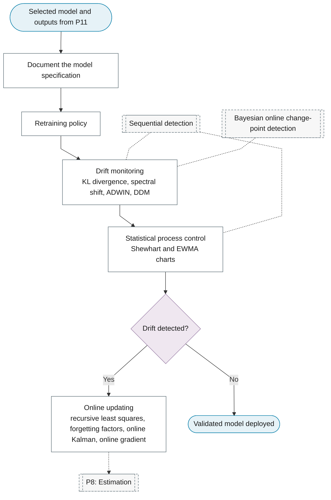

# P12: Deployment and monitoring

**Question this phase answers:** Does the deployed model keep working?

Documentation, the retraining policy, drift monitoring, statistical process control and the response to drift.

## Sub-diagram

## Phase guide

!!! note "Section pending"
    To-do item created from the flowchart inventory (node `P12`). Write this section following the content rules in `.claude/rules/writing.md`.

## Document the model specification

!!! note "Section pending"
    To-do item created from the flowchart inventory (node `P12_DOCUMENTATION`). Write this section following the content rules in `.claude/rules/writing.md`.

## Retraining policy

!!! note "Section pending"
    To-do item created from the flowchart inventory (node `P12_RETRAINING`). Write this section following the content rules in `.claude/rules/writing.md`.
