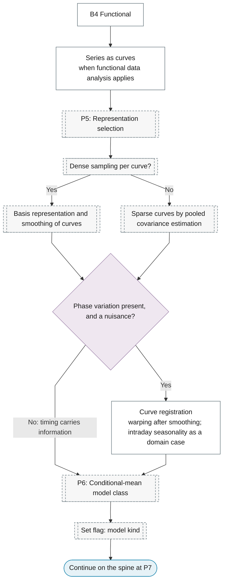

# 14. Functional and High-Frequency

The B4 branch (series as curves, basis smoothing, sparse curves, curve registration, functional principal components, functional regression) and autoregressive conditional durations. Ultra-high-frequency (tick) data is irregularly sampled (B3, area 15) and summarised by realised measures (area 10); survival models live in area 17. The page also hosts: sparse curves by pooled covariance estimation.

## Branch sub-diagram

## B4 Functional

!!! note "Section pending"
    To-do item created from the flowchart inventory (node `B4`). Write this section following the content rules in `.claude/rules/writing.md`.

## Series as curves

!!! note "Section pending"
    To-do item created from the flowchart inventory (node `B4_CURVES`). Write this section following the content rules in `.claude/rules/writing.md`.

## Basis representation and smoothing of curves

!!! note "Section pending"
    To-do item created from the flowchart inventory (node `P5_FN_BASIS`). Write this section following the content rules in `.claude/rules/writing.md`.

## Sparse curves by pooled covariance estimation

!!! note "Section pending"
    To-do item created from the flowchart inventory (node `P5_FN_PACE`). Write this section following the content rules in `.claude/rules/writing.md`.

## Curve registration

!!! note "Section pending"
    To-do item created from the flowchart inventory (node `B4_INTRADAY`). Write this section following the content rules in `.claude/rules/writing.md`.

## Functional principal components

!!! note "Section pending"
    To-do item created from the flowchart inventory (node `P5_FN_FPCA`). Write this section following the content rules in `.claude/rules/writing.md`.

## Functional regression and functional autoregression

!!! note "Section pending"
    To-do item created from the flowchart inventory (node `P5_FN_REGRESSION`). Write this section following the content rules in `.claude/rules/writing.md`.

## Autoregressive conditional duration

!!! note "Section pending"
    To-do item created from the flowchart inventory (node `B2_ACD`). Write this section following the content rules in `.claude/rules/writing.md`.
