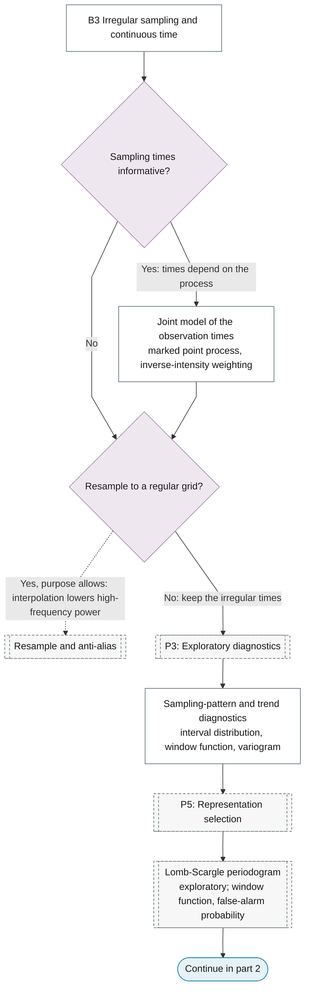
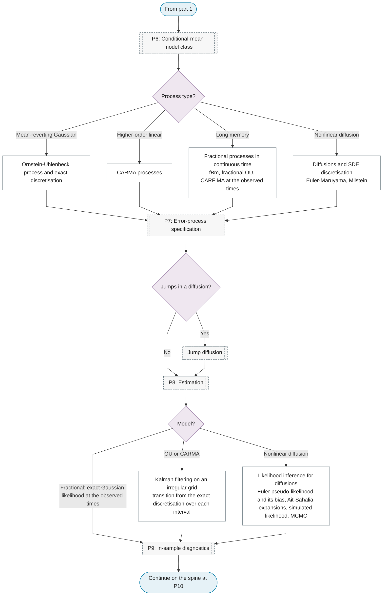

# 15. Continuous-Time Models

The B3 branch (informative sampling times, sampling-pattern diagnostics, the Ornstein-Uhlenbeck process, CARMA, fractional processes in continuous time, SDE discretisation, Kalman filtering on an irregular grid, likelihood inference for diffusions) and jump diffusion. Brownian motion and Levy processes are a Part 0 foundation. The branch chart is an index over the spine for a series that keeps its irregular times: the process type is chosen first, its exact discretisation over each interval defines the Kalman filter, and the filter gives the prediction-error likelihood.

## Branch sub-diagram

**Part 1: sampling times, diagnostics and representation.**

**Part 2: process type, discretisation and estimation.**

## B3 Irregular sampling and continuous time

!!! note "Section pending"
    To-do item created from the flowchart inventory (node `B3`). Write this section following the content rules in `.claude/rules/writing.md`.

## Joint model of the observation times

!!! note "Section pending"
    To-do item created from the flowchart inventory (node `B3_JOINT_SAMPLING`). Write this section following the content rules in `.claude/rules/writing.md`.

## Sampling-pattern and trend diagnostics

!!! note "Section pending"
    To-do item created from the flowchart inventory (node `B3_DIAGNOSTICS`). Write this section following the content rules in `.claude/rules/writing.md`.

## Ornstein-Uhlenbeck process and exact discretisation

!!! note "Section pending"
    To-do item created from the flowchart inventory (node `B3_OU`). Write this section following the content rules in `.claude/rules/writing.md`.

## CARMA processes

!!! note "Section pending"
    To-do item created from the flowchart inventory (node `B3_CARMA`). Write this section following the content rules in `.claude/rules/writing.md`.

## Fractional processes in continuous time

!!! note "Section pending"
    To-do item created from the flowchart inventory (node `B3_FBM`). Write this section following the content rules in `.claude/rules/writing.md`.

## Diffusions and SDE discretisation

!!! note "Section pending"
    To-do item created from the flowchart inventory (node `B3_SDE`). Write this section following the content rules in `.claude/rules/writing.md`.

## Jump diffusion

!!! note "Section pending"
    To-do item created from the flowchart inventory (node `P7_JUMPS`). Write this section following the content rules in `.claude/rules/writing.md`.

## Kalman filtering on an irregular grid

!!! note "Section pending"
    To-do item created from the flowchart inventory (node `B3_IRREGULAR_KALMAN`). Write this section following the content rules in `.claude/rules/writing.md`.

## Likelihood inference for diffusions

!!! note "Section pending"
    To-do item created from the flowchart inventory (node `B3_SDE_INFERENCE`). Write this section following the content rules in `.claude/rules/writing.md`.
