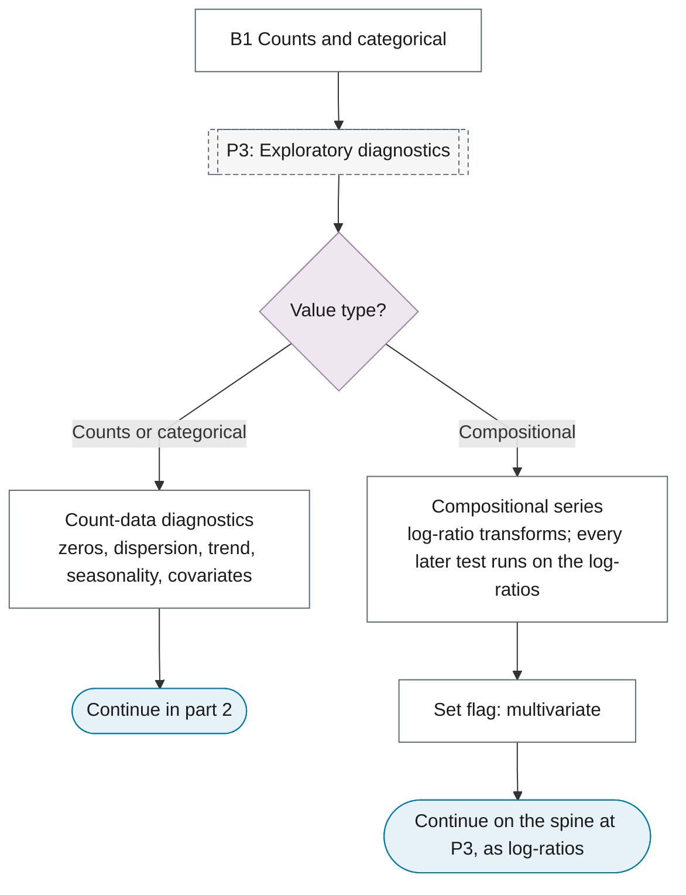
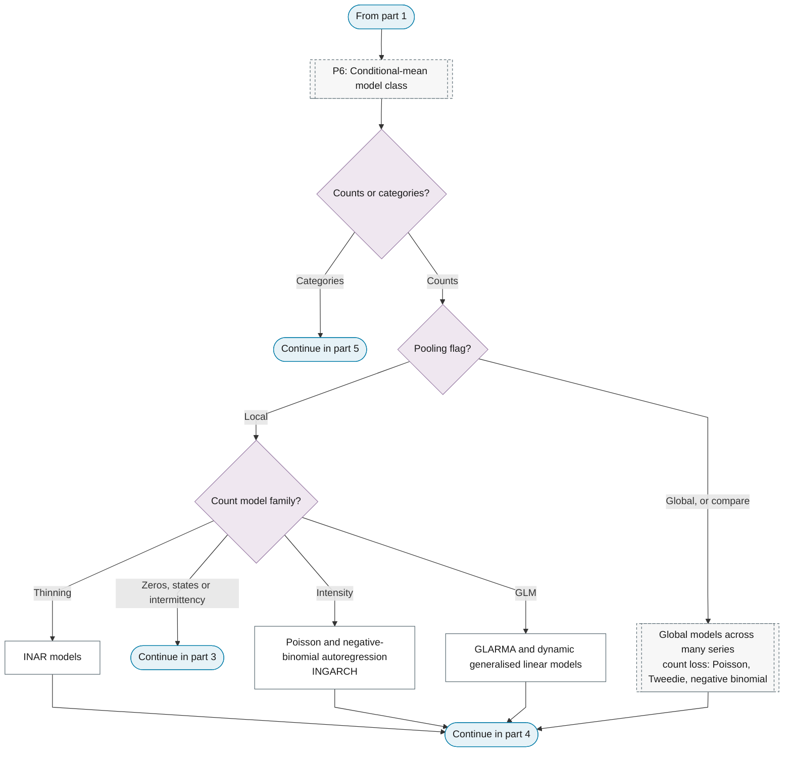
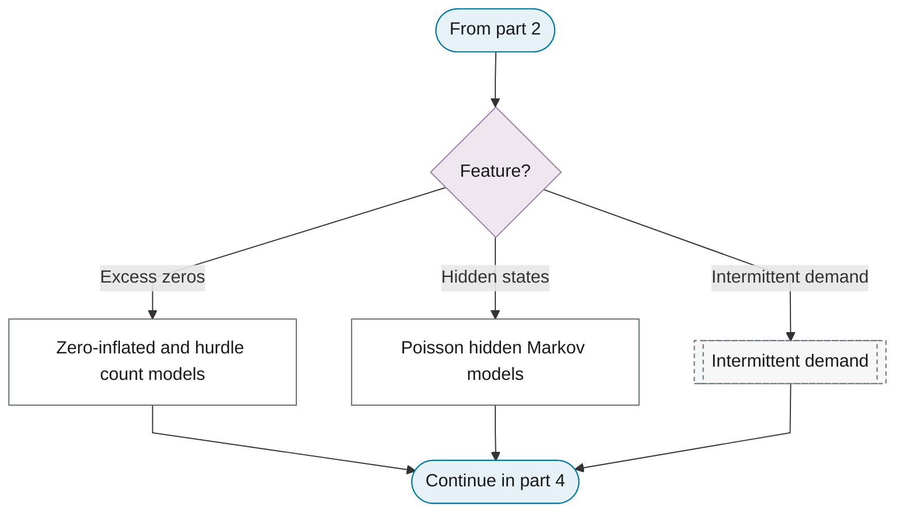
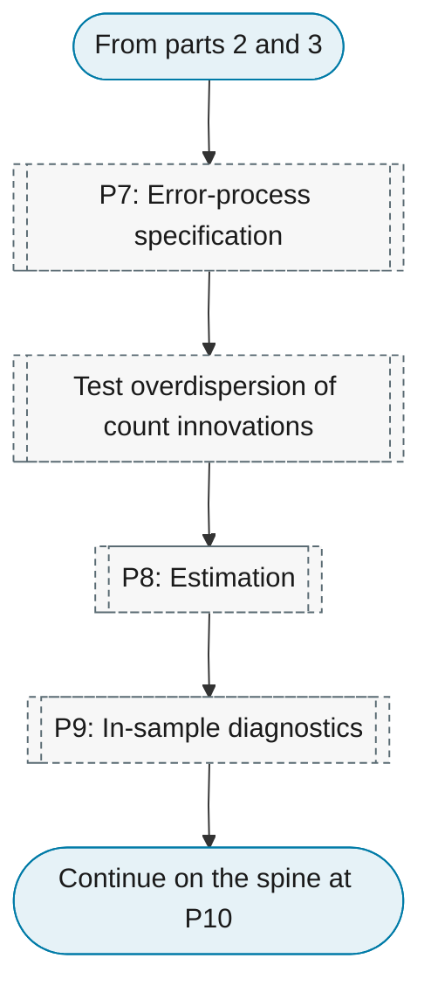
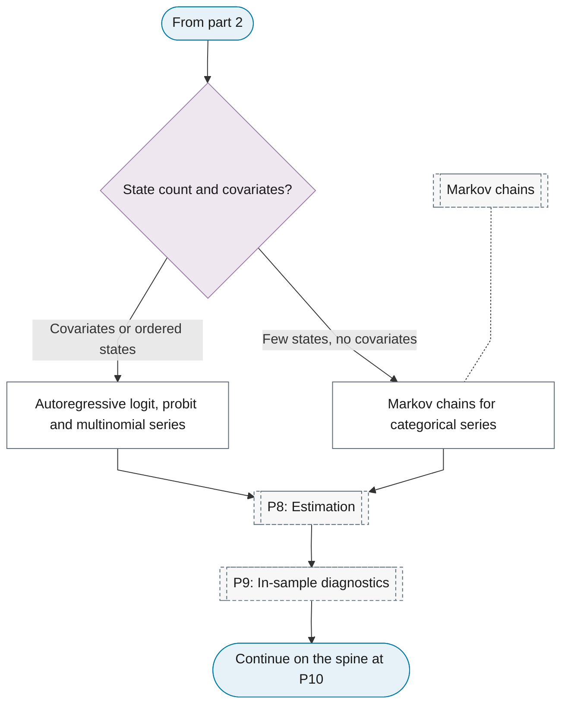

# 16. Count and Categorical

The B1 branch: count diagnostics, INAR, Poisson and negative-binomial autoregression, GLARMA, zero-inflated and hurdle counts, Poisson hidden Markov models, Markov chains, autoregressive logit and probit, compositional series, and the choice of count innovations. The branch chart is an index over the spine: it draws the phases a count, categorical or compositional series passes, with this chapter's leaves inside them, and returns to the spine at P10.

## Branch sub-diagram

**Part 1: diagnostics and value type.**

**Part 2: count models with dynamics in the mean.**

**Part 3: excess zeros, hidden states and intermittent demand.**

**Part 4: count innovations, estimation and diagnostics.**

**Part 5: categorical series.**

## B1 Counts and categorical

!!! note "Section pending"
    To-do item created from the flowchart inventory (node `B1`). Write this section following the content rules in `.claude/rules/writing.md`.

## Count-data diagnostics

!!! note "Section pending"
    To-do item created from the flowchart inventory (node `B1_COUNT_EDA`). Write this section following the content rules in `.claude/rules/writing.md`.

## Compositional series

!!! note "Section pending"
    To-do item created from the flowchart inventory (node `B1_COMPOSITIONAL`). Write this section following the content rules in `.claude/rules/writing.md`.

## INAR models

!!! note "Section pending"
    To-do item created from the flowchart inventory (node `B1_INAR`). Write this section following the content rules in `.claude/rules/writing.md`.

## Poisson and negative-binomial autoregression

!!! note "Section pending"
    To-do item created from the flowchart inventory (node `B1_POISSON_AR`). Write this section following the content rules in `.claude/rules/writing.md`.

## GLARMA and dynamic generalised linear models

!!! note "Section pending"
    To-do item created from the flowchart inventory (node `B1_GLARMA`). Write this section following the content rules in `.claude/rules/writing.md`.

## Zero-inflated and hurdle count models

!!! note "Section pending"
    To-do item created from the flowchart inventory (node `B1_ZERO_INFLATED`). Write this section following the content rules in `.claude/rules/writing.md`.

## Poisson hidden Markov models

!!! note "Section pending"
    To-do item created from the flowchart inventory (node `B1_POISSON_HMM`). Write this section following the content rules in `.claude/rules/writing.md`.

## Markov chains for categorical series

!!! note "Section pending"
    To-do item created from the flowchart inventory (node `B1_MARKOV_CHAIN`). Write this section following the content rules in `.claude/rules/writing.md`.

## Autoregressive logit, probit and multinomial series

!!! note "Section pending"
    To-do item created from the flowchart inventory (node `B1_AR_LOGIT`). Write this section following the content rules in `.claude/rules/writing.md`.

## Count innovations: Poisson or negative binomial

!!! note "Section pending"
    To-do item created from the flowchart inventory (node `P7_INGARCH`). Write this section following the content rules in `.claude/rules/writing.md`.
