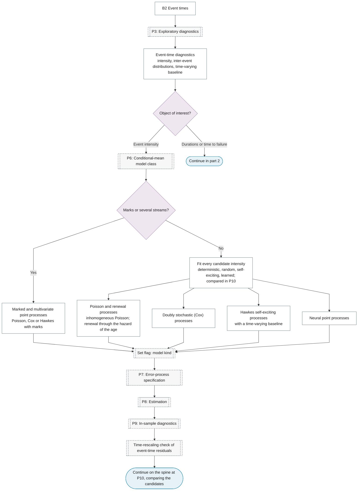
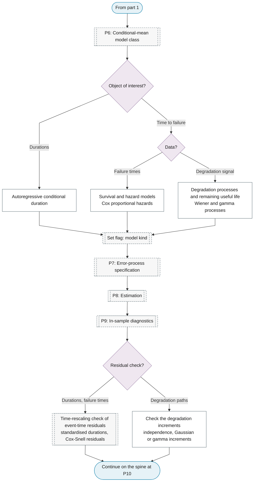

# 17. Point Processes

The B2 branch: Poisson, renewal and Cox processes, Hawkes, marked and neural point processes, survival and hazard models, and intensity misspecification. Durations live in area 14 and degradation models in area 26. The branch chart is an index over the spine: clustering of events can come from self-excitation or from a random intensity, so every candidate intensity model is fitted and the candidates are compared in P10, and every model is checked after estimation. The page also hosts: fit every candidate intensity, check the degradation increments.

## Branch sub-diagram

**Part 1: event intensity.**

**Part 2: durations and time to failure.**

## B2 Event times

!!! note "Section pending"
    To-do item created from the flowchart inventory (node `B2`). Write this section following the content rules in `.claude/rules/writing.md`.

## Event-time diagnostics

!!! note "Section pending"
    To-do item created from the flowchart inventory (node `B2_EVENT_EDA`). Write this section following the content rules in `.claude/rules/writing.md`.

## Fit every candidate intensity

!!! note "Section pending"
    To-do item created from the flowchart inventory (node `B2_FIT_ALL`). Write this section following the content rules in `.claude/rules/writing.md`.

## Marked and multivariate point processes

!!! note "Section pending"
    To-do item created from the flowchart inventory (node `B2_MARKED`). Write this section following the content rules in `.claude/rules/writing.md`.

## Poisson and renewal processes

!!! note "Section pending"
    To-do item created from the flowchart inventory (node `B2_POISSON`). Write this section following the content rules in `.claude/rules/writing.md`.

## Doubly stochastic (Cox) processes

!!! note "Section pending"
    To-do item created from the flowchart inventory (node `B2_COX`). Write this section following the content rules in `.claude/rules/writing.md`.

## Hawkes self-exciting processes

!!! note "Section pending"
    To-do item created from the flowchart inventory (node `B2_HAWKES`). Write this section following the content rules in `.claude/rules/writing.md`.

## Neural point processes

!!! note "Section pending"
    To-do item created from the flowchart inventory (node `B2_NEURAL_PP`). Write this section following the content rules in `.claude/rules/writing.md`.

## Intensity misspecification

!!! note "Section pending"
    To-do item created from the flowchart inventory (node `P7_INTENSITY`). Write this section following the content rules in `.claude/rules/writing.md`.

## Survival and hazard models

!!! note "Section pending"
    To-do item created from the flowchart inventory (node `B2_SURVIVAL`). Write this section following the content rules in `.claude/rules/writing.md`.

## Check the degradation increments

!!! note "Section pending"
    To-do item created from the flowchart inventory (node `B2_INCREMENT_CHECK`). Write this section following the content rules in `.claude/rules/writing.md`.
