# 32. Panel Time Series

The B6 branch: the cross-sectional dependence test, first- and second-generation panel unit-root and cointegration tests, fixed and random effects, dynamic panel GMM, heterogeneous panels, panel cointegration estimators and common correlated effects. The dependence test comes first because first-generation tests assume independent units and over-reject under common shocks.

## Branch sub-diagram

```mermaid
%%{init: {"flowchart": {"curve": "linear"}}}%%
graph TD
    B6["B6 Wide panel"] --> P3[["P3: Exploratory diagnostics"]]
    P3 --> B6_CROSS_SECTION_DEPENDENCE["Cross-sectional dependence test<br/>CD test"]
    B6_CROSS_SECTION_DEPENDENCE --> B6_CD{"Cross-sectional dependence?"}
    B6_CD -->|"Weak"| B6_PANEL_UNIT_ROOT["First-generation panel unit-root and cointegration tests<br/>LLC, IPS, Pedroni"]
    B6_CD -->|"Strong"| B6_CD_FLAG["Set flag: cross-sectional dependence"]
    B6_CD_FLAG --> B6_SECOND_GENERATION["Second-generation panel unit-root tests<br/>CIPS, PANIC"]
    B6_PANEL_UNIT_ROOT & B6_SECOND_GENERATION --> B6_VERDICT{"Panel verdict?"}
    B6_VERDICT -->|"Unit roots, cointegrated"| B6_COINT_FLAG["Set flag: panel cointegration"]
    B6_VERDICT -->|"Unit roots, not cointegrated"| P3_ORDER_FLAG[["Set flag: integration order k and fractional remainder<br/>k = 1 for every unit from the panel verdict; no fractional remainder"]]
    P3_ORDER_FLAG --> P4[["P4: Transformations"]]
    B6_VERDICT -->|"Stationary"| P6
    B6_COINT_FLAG & P4 --> P6[["P6: Conditional-mean model class"]]
    P6 --> B6_DYNAMIC{"Lagged dependent variable?"}
    B6_DYNAMIC -->|"No"| B6_STATIC_PANEL["Fixed and random effects"]
    B6_DYNAMIC -->|"Yes"| B6_DYNAMIC_PANEL["Dynamic panel GMM<br/>Arellano-Bond"]
    B6_STATIC_PANEL & B6_DYNAMIC_PANEL --> B6_HETERO{"Heterogeneous slopes?"}
    B6_HETERO -->|"Yes"| B6_HETEROGENEOUS["Heterogeneous panels<br/>mean group, pooled mean group"]
    B6_HETERO -->|"No"| P6_KIND_FLAG
    B6_HETEROGENEOUS --> P6_KIND_FLAG[["Set flag: model kind"]]
    P6_KIND_FLAG --> P8[["P8: Estimation"]]
    class P6_KIND_FLAG ref
    P8 --> B6_ESTIMATOR{"Panel flags?"}
    B6_ESTIMATOR -->|"Panel cointegration"| B6_PANEL_COINTEGRATION["Panel cointegration estimators<br/>panel DOLS and FMOLS, pooled mean group"]
    B6_ESTIMATOR -->|"Cross-sectional dependence"| B6_CCE["Common correlated effects estimators"]
    B6_ESTIMATOR -->|"Neither"| P9
    B6_PANEL_COINTEGRATION & B6_CCE --> P9[["P9: In-sample diagnostics"]]
    P9 --> B6_OUT(["Continue on the spine at P10"])
    class B6_OUT terminator
    class B6_CD,B6_VERDICT,B6_DYNAMIC,B6_HETERO,B6_ESTIMATOR decision
    class B6,B6_CROSS_SECTION_DEPENDENCE,B6_PANEL_UNIT_ROOT,B6_CD_FLAG,B6_SECOND_GENERATION,B6_COINT_FLAG,B6_STATIC_PANEL,B6_DYNAMIC_PANEL,B6_HETEROGENEOUS,B6_PANEL_COINTEGRATION,B6_CCE process
    class P3,P4,P6,P8,P9,P3_ORDER_FLAG ref
    classDef terminator fill:#E6F2F7,stroke:#007BA7,color:#1A1A1A;
    classDef process fill:#FFFFFF,stroke:#5A6B73,color:#1A1A1A;
    classDef decision fill:#EFE7F0,stroke:#9B7FA7,color:#1A1A1A;
    classDef data fill:#FFF4E0,stroke:#C9A55E,color:#1A1A1A;
    classDef good fill:#DCEFD8,stroke:#4A7A3F,color:#1A1A1A;
    classDef escalate fill:#FFE9C2,stroke:#C9A55E,color:#1A1A1A;
    classDef problem fill:#F2D9DE,stroke:#800020,color:#1A1A1A;
    classDef ref fill:#F7F7F7,stroke:#5A6B73,color:#1A1A1A,stroke-dasharray:4 3;
```

## B6 Wide panel

!!! note "Section pending"
    To-do item created from the flowchart inventory (node `B6`). Write this section following the content rules in `.claude/rules/writing.md`.

## Cross-sectional dependence test

!!! note "Section pending"
    To-do item created from the flowchart inventory (node `B6_CROSS_SECTION_DEPENDENCE`). Write this section following the content rules in `.claude/rules/writing.md`.

## First-generation panel unit-root and cointegration tests

!!! note "Section pending"
    To-do item created from the flowchart inventory (node `B6_PANEL_UNIT_ROOT`). Write this section following the content rules in `.claude/rules/writing.md`.

## Second-generation panel unit-root tests

!!! note "Section pending"
    To-do item created from the flowchart inventory (node `B6_SECOND_GENERATION`). Write this section following the content rules in `.claude/rules/writing.md`.

## Fixed and random effects

!!! note "Section pending"
    To-do item created from the flowchart inventory (node `B6_STATIC_PANEL`). Write this section following the content rules in `.claude/rules/writing.md`.

## Dynamic panel GMM

!!! note "Section pending"
    To-do item created from the flowchart inventory (node `B6_DYNAMIC_PANEL`). Write this section following the content rules in `.claude/rules/writing.md`.

## Heterogeneous panels

!!! note "Section pending"
    To-do item created from the flowchart inventory (node `B6_HETEROGENEOUS`). Write this section following the content rules in `.claude/rules/writing.md`.

## Panel cointegration estimators

!!! note "Section pending"
    To-do item created from the flowchart inventory (node `B6_PANEL_COINTEGRATION`). Write this section following the content rules in `.claude/rules/writing.md`.

## Common correlated effects estimators

!!! note "Section pending"
    To-do item created from the flowchart inventory (node `B6_CCE`). Write this section following the content rules in `.claude/rules/writing.md`.
